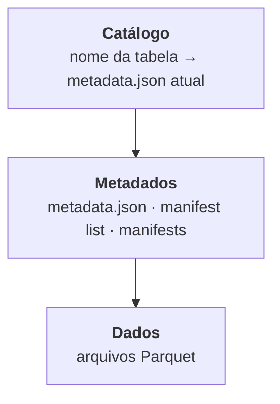
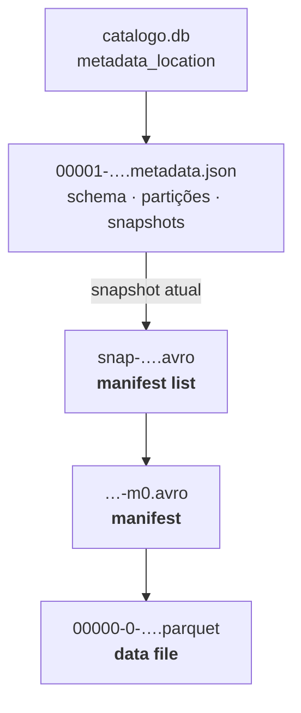
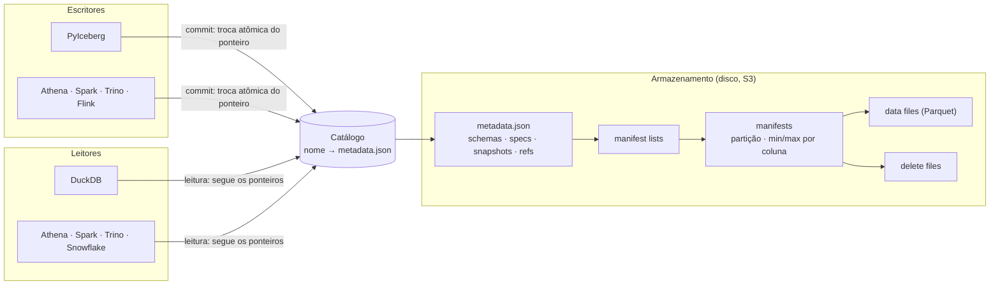

# Apache Iceberg: formato de tabela em disco

Author: Prof. Barbosa<br>
Contact: infobarbosa@gmail.com<br>
Github: [infobarbosa](https://github.com/infobarbosa)

[Apache Iceberg](https://iceberg.apache.org/) é um **open table format**: uma especificação de como organizar arquivos de dados (Parquet) e arquivos de metadados para que uma pasta num data lake se comporte como uma tabela de banco — com commits atômicos, versões, mudança de schema e de particionamento, e atualização de linhas. Ele não é um banco nem um motor: é um formato que vários motores sabem ler e escrever.

Este laboratório abre o Iceberg arquivo por arquivo. Você vai gravar uma tabela com um motor (**PyIceberg**), lê-la com outro (**DuckDB**) e, no final, com um terceiro (**Amazon Athena**), olhando a cada passo o que mudou no disco. O caso é o de um e-commerce real: os pedidos do **Olist**, um marketplace brasileiro.

Os comandos são copy-paste no terminal do laboratório, na ordem em que aparecem.

---

## O que você vai saber fazer ao final

- Explicar o que um formato de tabela resolve que uma pasta de arquivos Parquet não resolve.
- Descrever as três camadas do Iceberg — **catálogo, metadados e dados** — e seguir, num terminal, o caminho de uma consulta: catálogo → `metadata.json` → **manifest list** → **manifest** → **data file**.
- Explicar por que um **commit** é atômico e o que a **concorrência otimista** faz quando dois escritores gravam ao mesmo tempo.
- Consultar versões anteriores de uma tabela (**time travel**), marcar versões com **tags** e desfazer uma carga com **rollback**.
- Mudar o schema (**schema evolution**) e o particionamento (**partition evolution**) sem reescrever dados, e explicar o papel dos **field IDs**.
- Explicar o **hidden partitioning** e medir quantos arquivos o **pruning** evita ler.
- Atualizar e apagar linhas em **copy-on-write** e em **merge-on-read**, e dizer o que cada estratégia custa.
- Fazer a manutenção de uma tabela: compactar **small files**, expirar snapshots e remover arquivos órfãos — e saber quando um dado apagado de fato sai do disco.
- Gravar uma tabela Iceberg no **Amazon S3** com o **AWS Glue Data Catalog** e consultá-la e alterá-la no **Amazon Athena**.

---

## Pré-requisitos

- Acesso ao **AWS Academy** (o ambiente é uma instância EC2 criada por um script, logo a seguir; a Parte IV usa S3, Glue e Athena na mesma conta).
- Um navegador. Nada precisa ser instalado: o PyIceberg, o DuckDB, a AWS CLI e as ferramentas de inspeção de arquivos já vêm no ambiente.
- Familiaridade com SQL e uma leitura básica de Python.

Fora da aula, o mesmo ambiente roda em qualquer máquina com **Docker** — veja o [Apêndice C](#c-execução-local). A Parte IV precisa de uma conta AWS.

---

## Como o laboratório está organizado

| Parte | Assunto | Tempo |
|---|---|---|
| **I** | Do arquivo à tabela: catálogo, metadados, commits, time travel | ~2h30 |
| **II** | Mudar sem reescrever: schema, partições e partition evolution | ~1h30 |
| **III** | Atualizar dados imutáveis: upsert, delete e manutenção | ~1h30 |
| **IV** | Na AWS: S3, Glue Data Catalog e Athena | ~1h30 |
| — | Desafio | — |

Cada seção apresenta **um conceito** e em seguida a prática. As seções se empilham: a tabela que você cria na seção 3 é a que você inspeciona até a seção 6, e a da seção 8 é a que você atualiza na Parte III e leva para a nuvem na Parte IV.

### Os dados

O [Brazilian E-Commerce Public Dataset by Olist](https://www.kaggle.com/datasets/olistbr/brazilian-ecommerce) reúne cerca de **100 mil pedidos reais** (anonimizados) feitos entre 2016 e 2018 em marketplaces brasileiros. Os dados são da Olist, sob a licença [CC BY-NC-SA 4.0](https://creativecommons.org/licenses/by-nc-sa/4.0/); o laboratório baixa uma cópia de [infobarbosa/dataset-olist](https://github.com/infobarbosa/dataset-olist), que existe só para dispensar o login no Kaggle.

A tabela principal é a de pedidos. Cada pedido tem um ciclo de vida — comprado, aprovado, entregue à transportadora, entregue ao cliente — e o dataset traz a data de cada etapa. É isso que torna o caso bom para estudar um formato de tabela: **todo mês chegam pedidos novos e pedidos antigos mudam de status**.

### As ferramentas

| Ferramenta | Papel |
|---|---|
| `python3` + **PyIceberg** | grava as tabelas: cria, carrega, altera |
| **DuckDB** (`duckdb -c "..."`) | lê as tabelas e abre os arquivos de metadados e de dados |
| `jq`, `sqlite3`, `tree` | inspecionam os arquivos à mão |
| `lab.py` | módulo de apoio: `from lab import *` traz o catálogo, as cargas do Olist e funções de inspeção |

O `lab.py` existe para que cada bloco do roteiro tenha poucas linhas e mostre só o que importa. Ele está em `/opt/iceberg-lab/lab.py`, e vale abri-lo: as funções são curtas e comentadas.

### Convenções

Cada bloco de comando tem na primeira linha um rótulo, como `# 3.b.1` (subseção 3.b, primeiro bloco). Os blocos sem rótulo, logo depois, mostram a saída esperada.

Alguns valores **mudam a cada execução**: os IDs de snapshot, os UUIDs nos nomes de arquivo e os horários. Os seus não vão bater com os do texto — e isso é esperado. Contagens de linhas e de arquivos, essas sim, devem bater.

Os blocos marcados **Provoque este erro** falham de propósito: a mensagem de erro é a lição.

---

## Índice

[O ambiente](#o-ambiente)

**Parte I — Do arquivo à tabela**

2. [O problema: um data lake de Parquet "cru"](#2-o-problema-um-data-lake-de-parquet-cru)
3. [Catálogo, metadados e dados](#3-catálogo-metadados-e-dados)
4. [O primeiro commit: a árvore de metadados](#4-o-primeiro-commit-a-árvore-de-metadados)
5. [Snapshots e commits atômicos](#5-snapshots-e-commits-atômicos)
6. [Time travel, tags e rollback](#6-time-travel-tags-e-rollback)

**Parte II — Mudar sem reescrever**

7. [Schema evolution e field IDs](#7-schema-evolution-e-field-ids)
8. [Hidden partitioning e pruning](#8-hidden-partitioning-e-pruning)
9. [Partition evolution](#9-partition-evolution)

**Parte III — Atualizar dados imutáveis**

10. [Upsert e delete: copy-on-write](#10-upsert-e-delete-copy-on-write)
11. [Manutenção: o custo do histórico](#11-manutenção-o-custo-do-histórico)
12. [Um formato, vários motores](#12-um-formato-vários-motores)

**Parte IV — Na AWS**

13. [Do disco local para o S3 com o Glue Data Catalog](#13-do-disco-local-para-o-s3-com-o-glue-data-catalog)
14. [Athena: outro motor, merge-on-read](#14-athena-outro-motor-merge-on-read)
15. [Desafio](#15-desafio)

[Referências](#referências)

**Apêndices**

- [A. Encerrando o ambiente](#a-encerrando-o-ambiente)
- [B. Troubleshooting](#b-troubleshooting)
- [C. Execução local](#c-execução-local)

---

## O ambiente

O laboratório roda em uma instância **AWS EC2** (`t3.medium`) criada automaticamente a partir do **AWS CloudShell**. A instância executa um único container com o **code-server** (Visual Studio Code no navegador), o PyIceberg e o DuckDB.

Não há banco de dados para subir: o Iceberg é um formato de arquivos. O catálogo é um arquivo SQLite e cada tabela é uma pasta.

> **ATENÇÃO:**
> 1. **Região:** utilize sempre a região **Norte da Virgínia (`us-east-1`)** no Console AWS.
> 2. **Custos:** a instância EC2 e o volume EBS consomem créditos do seu laboratório AWS Academy. Ao encerrar a aula, garanta que a instância esteja parada (**Stopped**) ou aguarde o desligamento automático da sessão.
> 3. **Não recrie a máquina:** se a instância já existir, siga as instruções de [Retomando o laboratório](#retomando-o-laboratório).

### Passo 1: Abrir o AWS CloudShell

1. Faça login no Console da AWS através do seu painel do AWS Academy.
2. Certifique-se de que a região selecionada no canto superior direito é **N. Virginia (`us-east-1`)**.
3. No topo do console, clique no ícone do **AWS CloudShell** (`>_`) ao lado da barra de pesquisa.
4. Aguarde o terminal do CloudShell carregar.

### Passo 2: Executar o script de provisionamento

No terminal do CloudShell, execute:

```sh
curl -sS https://raw.githubusercontent.com/infobarbosa/iceberg-tableformat-demo/main/launch-lab.sh | bash

```

O script realiza de forma automatizada:

- Descoberta da VPC padrão e de uma subnet pública.
- Criação do Security Group `lab-iceberg-sg`, liberando as portas `8080` (IDE) e `22` (SSH).
- Lançamento da instância EC2 `lab-iceberg-tableformat` (`t3.medium`, Ubuntu 24.04, 20 GB gp3), com o perfil `LabInstanceProfile` — é por ele que o container acessa S3, Glue e Athena na Parte IV, sem chaves de acesso.
- Instalação do Docker e inicialização do container `iceberg-lab`.
- Exibição do IP público e do link de acesso.

### Passo 3: Acessar a IDE

1. Abra no navegador o link exibido ao final do script: `http://<IP-PUBLICO>:8080`.
2. Caso a página não responda, **aguarde de 3 a 5 minutos** para que o Docker conclua o download da imagem e atualize o navegador.
3. O code-server abre diretamente na IDE, sem solicitar senha.
4. Abra um terminal: menu superior (três linhas horizontais) > **Terminal** > **New Terminal**.

> **Atenção!** Todos os comandos deste laboratório são executados no **terminal do code-server**, na pasta `~/project` (onde o terminal já abre). O CloudShell só serve para criar a instância.

### Retomando o laboratório

Se a sessão do AWS Academy expirar, a instância será parada. **Não execute o `launch-lab.sh` novamente.**

1. No Console AWS (`us-east-1`), acesse **EC2** > **Instances**.
2. Selecione a instância **`lab-iceberg-tableformat`** e clique em **Instance state** > **Start instance**.
3. Aguarde o status **Running** e copie o novo **Public IPv4 address** (ele muda a cada reinício).
4. Acesse `http://<NOVO_IP_PUBLICO>:8080`. O container reinicia automaticamente, e tudo o que está em `~/project` — os dados baixados e as tabelas — é preservado.

Os recursos da Parte IV (bucket S3, database do Glue) também continuam na conta enquanto ela existir.

### Verificando o ambiente

```sh
curl -sS https://raw.githubusercontent.com/infobarbosa/iceberg-tableformat-demo/main/scripts/check.sh | bash

```

O script confere as ferramentas e diz em que ponto do roteiro as suas tabelas estão. Sempre que uma seção não se comportar como o texto descreve, rode-o: ele diz o que está faltando em vez de deixar você adivinhar.

### As ferramentas

```sh
python3 -c "import pyiceberg, pyarrow; print('PyIceberg', pyiceberg.__version__, '| pyarrow', pyarrow.__version__)"
duckdb -c "SELECT version()"

```

```
PyIceberg 0.12.0 | pyarrow 26.0.0
┌─────────────┐
│ "version"() │
│   varchar   │
├─────────────┤
│ v1.5.6      │
└─────────────┘
```

**→ Parte I.** Antes de criar a primeira tabela Iceberg, vale ver o problema que ela resolve. Para isso, você vai montar um data lake do jeito mais simples possível: uma pasta com arquivos Parquet.

---

# Parte I — Do arquivo à tabela

## 2. O problema: um data lake de Parquet "cru"

Um data lake guarda os dados como arquivos num armazenamento barato — um bucket S3, um HDFS, um disco. O formato mais comum é o **Parquet**, que é colunar, comprimido e traz estatísticas por coluna. Para consultar, um motor (Spark, Athena, DuckDB) lê os arquivos de uma pasta e trata o conjunto como uma tabela.

Essa "tabela", porém, é só uma convenção: **a tabela é o que estiver na pasta na hora da leitura**. Nesta seção você vai ver o que isso custa.

### 2.a. Os dados do Olist

```sh
# 2.a.1
mkdir -p dados
curl -sSL -o dados/olist_orders_dataset.csv.gz \
  https://raw.githubusercontent.com/infobarbosa/dataset-olist/main/data/olist_orders_dataset.csv.gz
curl -sSL -o dados/olist_products_dataset.csv.gz \
  https://raw.githubusercontent.com/infobarbosa/dataset-olist/main/data/olist_products_dataset.csv.gz
ls -lh dados

```

```
total 7.7M
-rw-r--r-- 1 barbosa barbosa 6.7M Oct 12 22:33 olist_orders_dataset.csv.gz
-rw-r--r-- 1 barbosa barbosa 1.1M Oct 12 22:33 olist_products_dataset.csv.gz
```

O DuckDB lê o CSV comprimido direto, sem carga prévia:

```sh
# 2.a.2
duckdb -c "DESCRIBE FROM 'dados/olist_orders_dataset.csv.gz'"

```

```
┌─────────────────────────────────────────┐
│    dados/olist_orders_dataset.csv.gz    │
│                                         │
│ order_id                      varchar   │
│ customer_id                   varchar   │
│ order_status                  varchar   │
│ order_purchase_timestamp      timestamp │
│ order_approved_at             timestamp │
│ order_delivered_carrier_date  timestamp │
│ order_delivered_customer_date timestamp │
│ order_estimated_delivery_date timestamp │
└─────────────────────────────────────────┘
```

Cada linha é um pedido. As quatro datas contam o ciclo de vida: compra (`purchase`), aprovação do pagamento (`approved`), entrega à transportadora (`delivered_carrier`) e entrega ao cliente (`delivered_customer`). A última, `estimated_delivery`, é a promessa feita ao cliente na compra.

```sh
# 2.a.3
duckdb -c "
SELECT strftime(order_purchase_timestamp, '%Y-%m') AS mes, count(*) AS pedidos
FROM 'dados/olist_orders_dataset.csv.gz'
WHERE order_purchase_timestamp >= '2017-01-01' AND order_purchase_timestamp < '2017-07-01'
GROUP BY ALL ORDER BY 1"

```

```
┌─────────┬─────────┐
│   mes   │ pedidos │
│ varchar │  int64  │
├─────────┼─────────┤
│ 2017-01 │     800 │
│ 2017-02 │    1780 │
│ 2017-03 │    2682 │
│ 2017-04 │    2404 │
│ 2017-05 │    3700 │
│ 2017-06 │    3245 │
└─────────┴─────────┘
```

O período útil do dataset vai de janeiro de 2017 a agosto de 2018. É nessa janela que o laboratório vai "carregar" o e-commerce, um mês por vez.

### 2.b. Um lake de arquivos

Grave os pedidos de janeiro a março de 2017 numa pasta, um Parquet por mês — é como muitos pipelines fazem:

```sh
# 2.b.1
mkdir -p lake/orders
for mes in 01 02 03; do
  duckdb -c "
  COPY (SELECT * FROM 'dados/olist_orders_dataset.csv.gz'
        WHERE strftime(order_purchase_timestamp, '%Y-%m') = '2017-$mes')
  TO 'lake/orders/2017-$mes.parquet'"
done
ls -l lake/orders

```

```
total 496
-rw-r--r-- 1 barbosa barbosa  77158 Oct 12 22:33 2017-01.parquet
-rw-r--r-- 1 barbosa barbosa 168081 Oct 12 22:33 2017-02.parquet
-rw-r--r-- 1 barbosa barbosa 254010 Oct 12 22:33 2017-03.parquet
```

E consulte a pasta inteira com um glob:

```sh
# 2.b.2
duckdb -c "
SELECT strftime(order_purchase_timestamp, '%Y-%m') AS mes, count(*) AS pedidos
FROM 'lake/orders/*.parquet' GROUP BY ALL ORDER BY 1"

```

```
┌─────────┬─────────┐
│   mes   │ pedidos │
│ varchar │  int64  │
├─────────┼─────────┤
│ 2017-01 │     800 │
│ 2017-02 │    1780 │
│ 2017-03 │    2682 │
└─────────┴─────────┘
```

Funciona — e para muita coisa basta. Agora, quatro situações corriqueiras.

### 2.c. Problema 1: a coluna mudou de nome

O cadastro de produtos do Olist tem um erro de digitação famoso: `product_name_lenght` (e não *length*). Imagine que o time de cadastro corrigiu o nome na exportação. Os produtos antigos ficaram num arquivo com o nome errado, e os novos chegam com o nome certo:

```sh
# 2.c.1
mkdir -p lake/products
duckdb -c "
COPY (SELECT * FROM 'dados/olist_products_dataset.csv.gz' WHERE hash(product_id) % 2 = 0)
TO 'lake/products/exportacao-1.parquet';
COPY (SELECT * RENAME (product_name_lenght AS product_name_length,
                       product_description_lenght AS product_description_length)
      FROM 'dados/olist_products_dataset.csv.gz' WHERE hash(product_id) % 2 = 1)
TO 'lake/products/exportacao-2.parquet'"
duckdb -c "SELECT avg(product_name_length) FROM 'lake/products/*.parquet'"

```

**Provoque este erro.** A consulta falha:

```
Binder Error: Referenced column "product_name_length" not found in FROM clause!
Candidate bindings: "product_name_lenght", "product_length_cm", "product_weight_g", "product_category_name", "product_height_cm"

LINE 1: SELECT avg(product_name_length) FROM 'lake/products/*.parquet'
                   ^
```

O DuckDB oferece `union_by_name`, que junta as colunas pelo nome. A consulta passa — e erra em silêncio:

```sh
# 2.c.2
duckdb -c "
SELECT count(*) AS produtos, count(product_name_length) AS com_tamanho, avg(product_name_length) AS media
FROM read_parquet('lake/products/*.parquet', union_by_name = true)"

```

```
┌──────────┬─────────────┬────────────────────┐
│ produtos │ com_tamanho │       media        │
│  int64   │    int64    │       double       │
├──────────┼─────────────┼────────────────────┤
│    32951 │       16066 │ 48.351549856840535 │
└──────────┴─────────────┴────────────────────┘
```

Metade dos produtos "não tem" tamanho de nome. O dado está lá, numa coluna chamada `product_name_lenght` que a consulta não pediu. Para o Parquet, **a identidade de uma coluna é o nome**, e um rename é, na prática, apagar uma coluna e criar outra.

### 2.d. Problema 2: um pedido mudou de status

Pegue um pedido de janeiro que, no fim do mês, ainda não tinha sido entregue:

```sh
# 2.d.1
duckdb -c "
SELECT order_id, order_status, order_purchase_timestamp, order_delivered_customer_date
FROM 'lake/orders/2017-01.parquet'
WHERE order_delivered_customer_date >= '2017-02-01'
ORDER BY order_purchase_timestamp DESC LIMIT 1"

```

```
┌──────────────────────────────────┬──────────────┬──────────────────────────┬───────────────────────────────┐
│             order_id             │ order_status │ order_purchase_timestamp │ order_delivered_customer_date │
│             varchar              │   varchar    │        timestamp         │           timestamp           │
├──────────────────────────────────┼──────────────┼──────────────────────────┼───────────────────────────────┤
│ 6225dae3fcc1416785f294cc07f2e4db │ delivered    │ 2017-01-31 23:37:58      │ 2017-02-13 13:23:46           │
└──────────────────────────────────┴──────────────┴──────────────────────────┴───────────────────────────────┘
```

O arquivo foi gravado com o estado final do pedido, mas na vida real a carga de janeiro teria registrado esse pedido ainda em trânsito, e a entrega chegaria depois. Quando chegar, como atualizar **uma linha**? Parquet é imutável: não existe `UPDATE` num arquivo. A única saída é reescrevê-lo inteiro:

```sh
# 2.d.2
duckdb -c "
COPY (SELECT * REPLACE (CASE WHEN order_delivered_customer_date >= '2017-02-01'
                             THEN 'shipped' ELSE order_status END AS order_status)
      FROM 'lake/orders/2017-01.parquet')
TO 'lake/orders/2017-01.tmp.parquet'"
mv lake/orders/2017-01.tmp.parquet lake/orders/2017-01.parquet
ls -l lake/orders

```

```
total 496
-rw-r--r-- 1 barbosa barbosa  77309 Oct 12 22:33 2017-01.parquet
-rw-r--r-- 1 barbosa barbosa 168081 Oct 12 22:33 2017-02.parquet
-rw-r--r-- 1 barbosa barbosa 254010 Oct 12 22:33 2017-03.parquet
```

Para mudar o status de alguns pedidos, o arquivo do mês inteiro foi lido e regravado. Com um mês de 7 mil pedidos isso é rápido; com um mês de 70 milhões, é uma tarde de cluster. E durante a reescrita, quem estivesse lendo...

### 2.e. Problema 3: a leitura no meio da escrita

Uma carga de abril grava quatro arquivos, um a cada dois segundos, em segundo plano. Enquanto isso, um relatório conta os pedidos:

```sh
# 2.e.1
( for parte in 1 2 3 4; do
    duckdb -c "
    COPY (SELECT * FROM 'dados/olist_orders_dataset.csv.gz'
          WHERE strftime(order_purchase_timestamp, '%Y-%m') = '2017-04'
            AND hash(order_id) % 4 = $parte - 1)
    TO 'lake/orders/2017-04-parte-$parte.parquet'"
    sleep 2
  done ) &
sleep 3
duckdb -c "SELECT count(*) AS pedidos_de_abril FROM 'lake/orders/2017-04-*.parquet'"
wait
duckdb -c "SELECT count(*) AS pedidos_de_abril FROM 'lake/orders/2017-04-*.parquet'"

```

```
┌──────────────────┐
│ pedidos_de_abril │
│      int64       │
├──────────────────┤
│             1204 │
└──────────────────┘
┌──────────────────┐
│ pedidos_de_abril │
│      int64       │
├──────────────────┤
│             2404 │
└──────────────────┘
```

O primeiro relatório contou abril pela metade — e não tinha como saber. Não existe, na pasta, nenhuma marca de "carga concluída": o leitor vê os arquivos que existirem na hora em que o motor lista a pasta.

### 2.f. Problema 4: qual era a tabela ontem?

O fechamento de fevereiro foi feito antes da correção da seção 2.d. Quantos pedidos de janeiro estavam `delivered` naquele fechamento? A pergunta não tem resposta: o arquivo antigo foi substituído pelo `mv`, e a pasta só conhece o presente.

```sh
# 2.f.1
ls -l lake/orders

```

```
total 736
-rw-r--r-- 1 barbosa barbosa  77309 Oct 12 22:33 2017-01.parquet
-rw-r--r-- 1 barbosa barbosa 168081 Oct 12 22:33 2017-02.parquet
-rw-r--r-- 1 barbosa barbosa 254010 Oct 12 22:33 2017-03.parquet
-rw-r--r-- 1 barbosa barbosa  59698 Oct 12 22:33 2017-04-parte-1.parquet
-rw-r--r-- 1 barbosa barbosa  58433 Oct 12 22:33 2017-04-parte-2.parquet
-rw-r--r-- 1 barbosa barbosa  57380 Oct 12 22:33 2017-04-parte-3.parquet
-rw-r--r-- 1 barbosa barbosa  60396 Oct 12 22:33 2017-04-parte-4.parquet
```

### 2.g. O que você deve conseguir explicar

- Por que, para um motor que lê uma pasta de Parquet, "a tabela" é o resultado de uma listagem de arquivos.
- Por que um rename de coluna quebra a leitura de arquivos antigos (2.c).
- Por que atualizar uma linha obriga a reescrever um arquivo (2.d) e o que acontece com quem está lendo durante a escrita (2.e).
- Por que não há como consultar o estado de ontem (2.f).

Guarde os quatro problemas. Cada um volta adiante, resolvido: o 2.e na seção 5, o 2.f na seção 6, o 2.c na seção 7 e o 2.d na seção 10.

---

## 3. Catálogo, metadados e dados

O Iceberg resolve os quatro problemas com uma ideia: **a tabela deixa de ser a pasta e passa a ser uma lista explícita de arquivos**, mantida em arquivos de metadados. Um leitor nunca lista a pasta: ele lê os metadados e abre exatamente os arquivos que estão listados ali.

São três camadas:



- **Catálogo**: guarda, para cada tabela, um único ponteiro — o caminho do `metadata.json` atual. Pode ser um banco relacional, o AWS Glue, um serviço REST. Aqui é um arquivo SQLite.
- **Metadados**: arquivos JSON e Avro que descrevem a tabela — schema, particionamento, versões e a lista de arquivos de dados de cada versão.
- **Dados**: arquivos Parquet comuns. O Iceberg não inventa um formato de dados novo.

### 3.a. Criando o catálogo e a tabela

```sh
# 3.a.1
python3 - <<'EOF'
from lab import *

c = catalogo()
c.create_namespace("olist")
t = c.create_table("olist.orders", schema=pedidos_novos("2017-01").schema)
print(t.schema())
EOF

```

```
table {
  1: order_id: optional string
  2: customer_id: optional string
  3: order_status: optional string
  4: order_purchase_timestamp: optional timestamp
  5: order_approved_at: optional timestamp
  6: order_delivered_carrier_date: optional timestamp
  7: order_delivered_customer_date: optional timestamp
  8: order_estimated_delivery_date: optional timestamp
}
```

Três coisas aconteceram: o catálogo foi criado (`catalogo()` aponta para `warehouse/catalogo.db`), o namespace `olist` — o equivalente a um database ou schema — e a tabela `orders`, com o schema dos pedidos. A tabela ainda está **vazia**: `pedidos_novos("2017-01")` foi usado só para tirar dele o schema.

Repare nos números antes de cada coluna. São os **field IDs**: cada coluna recebe um ID inteiro quando nasce, e ele nunca muda. Eles serão a chave da seção 7.

### 3.b. O que existe no disco

```sh
# 3.b.1
tree warehouse

```

```
warehouse
├── catalogo.db
└── olist
    └── orders
        └── metadata
            └── 00000-42bfe785-e881-4469-86a4-009d1d4d1a2a.metadata.json

4 directories, 2 files
```

Um arquivo de catálogo e um de metadados. Nenhum dado. Abra o `metadata.json`:

```sh
# 3.b.2
jq '{"format-version", location, "current-snapshot-id", snapshots,
     schema: .schemas[0].fields | map("\(.id): \(.name) \(.type)")}' \
   warehouse/olist/orders/metadata/00000-*.metadata.json

```

```
{
  "format-version": 2,
  "location": "file:///home/barbosa/project/warehouse/olist/orders",
  "current-snapshot-id": null,
  "snapshots": [],
  "schema": [
    "1: order_id string",
    "2: customer_id string",
    "3: order_status string",
    "4: order_purchase_timestamp timestamp",
    "5: order_approved_at timestamp",
    "6: order_delivered_carrier_date timestamp",
    "7: order_delivered_customer_date timestamp",
    "8: order_estimated_delivery_date timestamp"
  ]
}
```

- `format-version: 2` — a versão da especificação do Iceberg que a tabela segue.
- `location` — a pasta-raiz da tabela. Note que é um **caminho absoluto**; isso vai importar na seção 13.
- `current-snapshot-id: null` e `snapshots: []` — a tabela ainda não tem nenhuma versão com dados.

### 3.c. O catálogo guarda só um ponteiro

```sh
# 3.c.1
sqlite3 -line warehouse/catalogo.db \
  "SELECT table_namespace, table_name, metadata_location, previous_metadata_location FROM iceberg_tables"

```

```
           table_namespace = olist
                table_name = orders
         metadata_location = file:///home/barbosa/project/warehouse/olist/orders/metadata/00000-42bfe785-e881-4469-86a4-009d1d4d1a2a.metadata.json
previous_metadata_location =
```

Essa linha é tudo o que o catálogo sabe sobre a tabela: o nome e o caminho do `metadata.json` atual. Todo o resto — schema, versões, arquivos — está nos metadados. É por isso que trocar de catálogo (de SQLite para Glue, por exemplo) é uma operação pequena: os metadados vão junto com os dados.

### 3.d. O que você deve conseguir explicar

- As três camadas do Iceberg e o que cada uma guarda.
- Por que um leitor de tabela Iceberg não precisa listar a pasta.
- O que é o field ID de uma coluna.
- O que o catálogo guarda — e o que ele não guarda.

---

## 4. O primeiro commit: a árvore de metadados

Uma gravação no Iceberg é um **commit**: o escritor grava os arquivos de dados, depois os arquivos de metadados que os descrevem, e por fim troca o ponteiro no catálogo. Cada commit cria um **snapshot** — uma versão completa da tabela.

### 4.a. Carregando janeiro de 2017

`pedidos_novos("2017-01")` devolve os pedidos comprados em janeiro, **no estado em que estavam no último dia de janeiro**: um pedido entregue em fevereiro aparece como `shipped`, sem data de entrega. (A função reconstrói esse estado a partir das datas do ciclo de vida; o SQL está no `lab.py`.)

```sh
# 4.a.1
python3 - <<'EOF'
from lab import *

t = tabela()
t.append(pedidos_novos("2017-01"))
print(t.current_snapshot())
EOF

```

```
Operation.APPEND: id=2131756834734027053, schema_id=0
```

```sh
# 4.a.2
tree warehouse/olist/orders

```

```
warehouse/olist/orders
├── data
│   └── 00000-0-e8791198-c25a-4af1-9493-c6f08789f7bd.parquet
└── metadata
    ├── 00000-42bfe785-e881-4469-86a4-009d1d4d1a2a.metadata.json
    ├── 00001-6561e41b-5c97-4a90-a77b-498bd0a24181.metadata.json
    ├── e8791198-c25a-4af1-9493-c6f08789f7bd-m0.avro
    └── snap-2131756834734027053-0-e8791198-c25a-4af1-9493-c6f08789f7bd.avro

3 directories, 5 files
```

O commit criou quatro arquivos: um Parquet em `data/` e três de metadados. Cada um é um nível da árvore que um leitor percorre:



Você vai descer a árvore um nível por vez.

### 4.b. O metadata.json: o snapshot

```sh
# 4.b.1
jq '.snapshots' warehouse/olist/orders/metadata/00001-*.metadata.json

```

```
[
  {
    "snapshot-id": 2131756834734027053,
    "sequence-number": 1,
    "timestamp-ms": 1791844396653,
    "manifest-list": "file:///home/barbosa/project/warehouse/olist/orders/metadata/snap-2131756834734027053-0-e8791198-c25a-4af1-9493-c6f08789f7bd.avro",
    "summary": {
      "operation": "append",
      "added-files-size": "51528",
      "added-data-files": "1",
      "added-records": "800",
      "total-data-files": "1",
      "total-delete-files": "0",
      "total-records": "800",
      "total-files-size": "51528",
      "total-position-deletes": "0",
      "total-equality-deletes": "0"
    },
    "schema-id": 0
  }
]
```

O snapshot registra a operação (`append`), o que ela acrescentou (`added-records`, `added-data-files`) e o total da tabela depois dela. E aponta para um arquivo: a `manifest-list`.

### 4.c. A manifest list

Os arquivos de metadados do Iceberg, fora o `metadata.json`, são **Avro**: um formato binário, orientado a linhas, com o schema embutido. O DuckDB lê Avro:

```sh
# 4.c.1
duckdb -line -c "
SELECT manifest_path, added_snapshot_id, added_files_count, added_rows_count, partition_spec_id
FROM read_avro('warehouse/olist/orders/metadata/snap-*.avro')"

```

```
    manifest_path = file:///home/barbosa/project/warehouse/olist/orders/metadata/e8791198-c25a-4af1-9493-c6f08789f7bd-m0.avro
added_snapshot_id = 2131756834734027053
added_files_count = 1
 added_rows_count = 800
partition_spec_id = 0
```

A manifest list é a lista de **manifests** de um snapshot, com um resumo de cada um (quantos arquivos, quantas linhas). Este snapshot tem um manifest só.

### 4.d. O manifest

```sh
# 4.d.1
duckdb -line -c "
SELECT status, data_file.file_path, data_file.file_format,
       data_file.record_count, data_file.file_size_in_bytes
FROM read_avro('warehouse/olist/orders/metadata/*-m0.avro')"

```

```
            status = 1
         file_path = file:///home/barbosa/project/warehouse/olist/orders/data/00000-0-e8791198-c25a-4af1-9493-c6f08789f7bd.parquet
       file_format = PARQUET
      record_count = 800
file_size_in_bytes = 51528
```

O manifest lista os **data files**, um por linha, com o caminho completo, o formato, o número de linhas e o tamanho. Guarda também estatísticas por coluna — mínimo, máximo, contagem de nulos —, gravadas em binário. O PyIceberg mostra as mesmas estatísticas decodificadas:

```sh
# 4.d.2
python3 - <<'EOF'
from lab import *
import duckdb

arquivos = tabela().inspect.files().select(["record_count", "readable_metrics"])
duckdb.sql("""
    SELECT record_count,
           readable_metrics.order_purchase_timestamp.lower_bound AS compra_min,
           readable_metrics.order_purchase_timestamp.upper_bound AS compra_max,
           readable_metrics.order_delivered_customer_date.null_value_count AS sem_entrega
    FROM arquivos
""").show()
EOF

```

```
┌──────────────┬─────────────────────┬─────────────────────┬─────────────┐
│ record_count │     compra_min      │     compra_max      │ sem_entrega │
│    int64     │      timestamp      │      timestamp      │    int64    │
├──────────────┼─────────────────────┼─────────────────────┼─────────────┤
│          800 │ 2017-01-05 11:56:06 │ 2017-01-31 23:37:58 │         517 │
└──────────────┴─────────────────────┴─────────────────────┴─────────────┘
```

Os pedidos vão de 5 a 31 de janeiro, e 517 dos 800 ainda não tinham data de entrega no fim do mês. É com esse mínimo e máximo que um leitor decide se precisa abrir um arquivo: uma consulta por pedidos de março nem toca neste arquivo, porque o máximo dele é janeiro. Isso é o **pruning**, e é assunto da seção 8.

### 4.e. O data file

Embaixo de tudo, um Parquet comum:

```sh
# 4.e.1
duckdb -c "
SELECT name, type, field_id
FROM parquet_schema('warehouse/olist/orders/data/*.parquet')"

```

```
┌───────────────────────────────┬────────────┬──────────┐
│             name              │    type    │ field_id │
│            varchar            │  varchar   │  int64   │
├───────────────────────────────┼────────────┼──────────┤
│ schema                        │ NULL       │     NULL │
│ order_id                      │ BYTE_ARRAY │        1 │
│ customer_id                   │ BYTE_ARRAY │        2 │
│ order_status                  │ BYTE_ARRAY │        3 │
│ order_purchase_timestamp      │ INT64      │        4 │
│ order_approved_at             │ INT64      │        5 │
│ order_delivered_carrier_date  │ INT64      │        6 │
│ order_delivered_customer_date │ INT64      │        7 │
│ order_estimated_delivery_date │ INT64      │        8 │
└───────────────────────────────┴────────────┴──────────┘
```

Quase um Parquet comum: cada coluna carrega o seu **field ID** do Iceberg (`field_id`). É assim que, na seção 7, um arquivo gravado com um nome de coluna antigo vai continuar legível.

### 4.f. O leitor segue os ponteiros

O DuckDB lê a tabela a partir do `metadata.json` — sem catálogo e sem listar a pasta:

```sh
# 4.f.1
M=$(ls warehouse/olist/orders/metadata/00001-*.metadata.json)
duckdb -c "
SELECT order_status, count(*) AS pedidos
FROM iceberg_scan('$M') GROUP BY ALL ORDER BY 2 DESC"

```

```
┌──────────────┬─────────┐
│ order_status │ pedidos │
│   varchar    │  int64  │
├──────────────┼─────────┤
│ shipped      │     329 │
│ delivered    │     283 │
│ approved     │     121 │
│ created      │      37 │
│ invoiced     │      11 │
│ processing   │       8 │
│ unavailable  │       8 │
│ canceled     │       3 │
└──────────────┴─────────┘
```

O `iceberg_scan` recebe o caminho de **um** `metadata.json`, porque é esse arquivo que define a versão da tabela. A leitura dá os 800 pedidos de janeiro, muitos ainda não entregues no fim do mês.

### 4.g. O que você deve conseguir explicar

- Os quatro níveis da árvore — metadata.json, manifest list, manifest, data file — e o que cada um guarda.
- O que é um snapshot.
- Onde ficam as estatísticas por coluna e para que servem.
- Por que um leitor de Iceberg nunca vê um arquivo que não esteja listado num manifest.

---

## 5. Snapshots e commits atômicos

### 5.a. Mais dois meses

```sh
# 5.a.1
python3 - <<'EOF'
from lab import *

t = tabela()
for mes in ["2017-02", "2017-03"]:
    t.append(pedidos_novos(mes))
mostra(t.inspect.snapshots(), ["committed_at", "snapshot_id", "parent_id", "operation"])
EOF

```

```
┌─────────────────────────┬─────────────────────┬─────────────────────┬───────────┐
│      committed_at       │     snapshot_id     │      parent_id      │ operation │
│      timestamp_ms       │        int64        │        int64        │  varchar  │
├─────────────────────────┼─────────────────────┼─────────────────────┼───────────┤
│ 2026-10-12 22:33:16.653 │ 2131756834734027053 │                NULL │ append    │
│ 2026-10-12 22:33:17.96  │ 7296911361541680023 │ 2131756834734027053 │ append    │
│ 2026-10-12 22:33:18.121 │ 7865760153420897185 │ 7296911361541680023 │ append    │
└─────────────────────────┴─────────────────────┴─────────────────────┴───────────┘
```

Três snapshots, cada um com um pai (`parent_id`). E no disco:

```sh
# 5.a.2
ls -1 warehouse/olist/orders/metadata/

```

```
00000-42bfe785-e881-4469-86a4-009d1d4d1a2a.metadata.json
00001-6561e41b-5c97-4a90-a77b-498bd0a24181.metadata.json
00002-2d48e355-1bc1-4363-bd9e-1cdd69bd26f1.metadata.json
00003-cae21a96-08d3-4352-b83f-c350dbb0a2db.metadata.json
6b29f426-926e-4f0f-8509-46702e461475-m0.avro
8b1b2a09-f490-4836-814f-66517991fd1c-m0.avro
e8791198-c25a-4af1-9493-c6f08789f7bd-m0.avro
snap-2131756834734027053-0-e8791198-c25a-4af1-9493-c6f08789f7bd.avro
snap-7296911361541680023-0-6b29f426-926e-4f0f-8509-46702e461475.avro
snap-7865760153420897185-0-8b1b2a09-f490-4836-814f-66517991fd1c.avro
```

Cada commit deixou um `metadata.json` novo (`00002-`, `00003-`) — **os anteriores não foram alterados**. Nada no Iceberg é editado no lugar: cada versão é um conjunto novo de arquivos de metadados, e os de versões anteriores continuam lá.

### 5.b. A manifest list reaproveita manifests

```sh
# 5.b.1
M=$(sqlite3 warehouse/catalogo.db "SELECT metadata_location FROM iceberg_tables WHERE table_name = 'orders'")
LISTA=$(jq -r '.snapshots[-1]."manifest-list"' "${M#file://}")
duckdb -c "
SELECT manifest_path, added_snapshot_id, added_rows_count
FROM read_avro('${LISTA#file://}')"

```

```
┌───────────────────────────────────────────────────────────────────────────────────────────────────────────┬─────────────────────┬──────────────────┐
│                                               manifest_path                                               │  added_snapshot_id  │ added_rows_count │
│                                                  varchar                                                  │        int64        │      int64       │
├───────────────────────────────────────────────────────────────────────────────────────────────────────────┼─────────────────────┼──────────────────┤
│ file:///home/barbosa/project/warehouse/olist/orders/metadata/8b1b2a09-f490-4836-814f-66517991fd1c-m0.avro │ 7865760153420897185 │             2682 │
│ file:///home/barbosa/project/warehouse/olist/orders/metadata/6b29f426-926e-4f0f-8509-46702e461475-m0.avro │ 7296911361541680023 │             1780 │
│ file:///home/barbosa/project/warehouse/olist/orders/metadata/e8791198-c25a-4af1-9493-c6f08789f7bd-m0.avro │ 2131756834734027053 │              800 │
└───────────────────────────────────────────────────────────────────────────────────────────────────────────┴─────────────────────┴──────────────────┘
```

A manifest list do snapshot de março tem três manifests: o de março, que ele criou, e os de janeiro e fevereiro, que ele **aponta** sem copiar. Um commit grava só o que mudou; o resto é reaproveitado por referência.

O bloco acima também fez, à mão, o caminho de um leitor: perguntou ao catálogo onde está o `metadata.json` atual, leu nele a manifest list do snapshot atual e abriu a lista.

### 5.c. A troca do ponteiro

```sh
# 5.c.1
sqlite3 -line warehouse/catalogo.db \
  "SELECT metadata_location, previous_metadata_location FROM iceberg_tables WHERE table_name = 'orders'"

```

```
         metadata_location = file:///home/barbosa/project/warehouse/olist/orders/metadata/00003-cae21a96-08d3-4352-b83f-c350dbb0a2db.metadata.json
previous_metadata_location = file:///home/barbosa/project/warehouse/olist/orders/metadata/00002-2d48e355-1bc1-4363-bd9e-1cdd69bd26f1.metadata.json
```

O commit termina com um único `UPDATE` nessa linha, trocando o ponteiro do `metadata.json` anterior para o novo — e só se o ponteiro ainda for o que o escritor leu no início. É essa troca, atômica, que faz o commit ser atômico: **antes dela, nenhum leitor enxerga os arquivos novos; depois dela, todos enxergam todos**.

É o problema 2.e resolvido. Uma carga em andamento grava data files e manifests que nenhum `metadata.json` aponta ainda; um leitor que chega nesse meio-tempo lê o snapshot anterior, inteiro e coerente.

### 5.d. Dois escritores ao mesmo tempo

E se dois processos fizerem commit ao mesmo tempo? Simule: duas "sessões" carregam a tabela, e as duas gravam abril.

```sh
# 5.d.1
python3 - <<'EOF'
from lab import *

sessao_a = tabela()
sessao_b = tabela()          # as duas leram o mesmo metadata.json

sessao_a.append(pedidos_novos("2017-04"))
sessao_b.append(pedidos_novos("2017-04"))

mostra(tabela().inspect.snapshots(), ["snapshot_id", "parent_id", "operation"])
EOF

```

```
Commit failed due to a concurrent update, retrying (1/4) in 108 ms
┌─────────────────────┬─────────────────────┬───────────┐
│     snapshot_id     │      parent_id      │ operation │
│        int64        │        int64        │  varchar  │
├─────────────────────┼─────────────────────┼───────────┤
│ 2131756834734027053 │                NULL │ append    │
│ 7296911361541680023 │ 2131756834734027053 │ append    │
│ 7865760153420897185 │ 7296911361541680023 │ append    │
│  281485491193889325 │ 7865760153420897185 │ append    │
│ 3246762794402949386 │  281485491193889325 │ append    │
└─────────────────────┴─────────────────────┴───────────┘
```

A sessão B tentou trocar o ponteiro, descobriu que ele já não era o que ela tinha lido ("Commit failed due to a concurrent update") e **tentou de novo**: recarregou os metadados, refez o commit em cima do snapshot da sessão A e entrou. É a **concorrência otimista**: ninguém trava a tabela; quem chega atrasado verifica se o seu commit ainda faz sentido e o reaplica.

Para dois `append`, fazer sentido é fácil: acrescentar arquivos nunca conflita. O resultado é que abril entrou **duas vezes** — o Iceberg garante que cada commit é atômico, não que o pipeline seja correto. Esse abril duplicado será desfeito na seção 6.

Nem todo conflito se resolve sozinho. Duas mudanças de schema simultâneas, por exemplo, não podem ser reaplicadas às cegas. Numa tabela de teste:

```sh
# 5.d.2
python3 - <<'EOF'
from lab import *
from pyiceberg.types import StringType

c = catalogo()
c.create_table("olist.teste_conflito", schema=pedidos_novos("2017-01").schema)
sessao_a = c.load_table("olist.teste_conflito")
sessao_b = c.load_table("olist.teste_conflito")

with sessao_a.update_schema() as u:
    u.add_column("canal_de_venda", StringType())
try:
    with sessao_b.update_schema() as u:
        u.add_column("cupom", StringType())
except Exception as erro:
    print(type(erro).__name__, "->", erro)

c.purge_table("olist.teste_conflito")
EOF

```

**Provoque este erro.**

```
CommitFailedException -> Requirement failed: current schema id has changed: expected 0, found 1
```

A sessão B partiu do schema 0 e encontrou o schema 1. O commit é recusado, e cabe à aplicação recarregar a tabela e decidir o que fazer.

### 5.e. O que você deve conseguir explicar

- Por que cada commit cria um `metadata.json` novo em vez de alterar o anterior.
- Como uma manifest list reaproveita manifests de snapshots anteriores.
- Por que a troca do ponteiro no catálogo torna o commit atômico, e como isso resolve o problema 2.e.
- O que é concorrência otimista, por que dois `append` simultâneos não conflitam e por que duas mudanças de schema conflitam.

---

## 6. Time travel, tags e rollback

Cada snapshot é uma versão completa e imutável da tabela. Ler uma versão antiga é só começar a descida da árvore por outro snapshot.

### 6.a. A tabela em cada versão

```sh
# 6.a.1
python3 - <<'EOF'
from lab import *

t = tabela()
for s in t.snapshots():
    pedidos = t.scan(snapshot_id=s.snapshot_id).to_arrow()
    print(s.snapshot_id, s.summary.operation.value, f"{pedidos.num_rows:6} pedidos")
EOF

```

```
2131756834734027053 append    800 pedidos
7296911361541680023 append   2580 pedidos
7865760153420897185 append   5262 pedidos
281485491193889325 append   7666 pedidos
3246762794402949386 append  10070 pedidos
```

Cinco versões: janeiro, fevereiro, março, abril — e abril de novo. É o problema 2.f resolvido: a tabela lembra cada estado pelo qual passou.

O DuckDB também viaja no tempo, a partir do mesmo `metadata.json`:

```sh
# 6.a.2
M=$(sqlite3 warehouse/catalogo.db "SELECT metadata_location FROM iceberg_tables WHERE table_name = 'orders'")
duckdb -c "SELECT sequence_number, snapshot_id, timestamp_ms FROM iceberg_snapshots('$M') ORDER BY 1"
PRIMEIRO=$(duckdb -noheader -list -c "SELECT snapshot_id FROM iceberg_snapshots('$M') ORDER BY sequence_number LIMIT 1")
duckdb -c "SELECT count(*) AS pedidos_no_primeiro_snapshot FROM iceberg_scan('$M', snapshot_from_id = $PRIMEIRO)"

```

```
┌─────────────────┬─────────────────────┬─────────────────────────┐
│ sequence_number │     snapshot_id     │      timestamp_ms       │
│     uint64      │       uint64        │        timestamp        │
├─────────────────┼─────────────────────┼─────────────────────────┤
│               1 │ 2131756834734027053 │ 2026-10-12 22:33:16.653 │
│               2 │ 7296911361541680023 │ 2026-10-12 22:33:17.96  │
│               3 │ 7865760153420897185 │ 2026-10-12 22:33:18.121 │
│               4 │  281485491193889325 │ 2026-10-12 22:33:18.86  │
│               5 │ 3246762794402949386 │ 2026-10-12 22:33:19.14  │
└─────────────────┴─────────────────────┴─────────────────────────┘
┌──────────────────────────────┐
│ pedidos_no_primeiro_snapshot │
│            int64             │
├──────────────────────────────┤
│                          800 │
└──────────────────────────────┘
```

### 6.b. Tags: dar nome a uma versão

O snapshot de março é o do fechamento do primeiro trimestre. Em vez de anotar o ID, dê um nome a ele:

```sh
# 6.b.1
python3 - <<'EOF'
from lab import *

t = tabela()
marco = t.snapshots()[2]
t.manage_snapshots().create_tag(marco.snapshot_id, "fechamento-2017-q1").commit()

mostra(t.inspect.refs(), ["name", "type", "snapshot_id"])
fechamento = t.snapshot_by_name("fechamento-2017-q1")
print("pedidos no fechamento:", t.scan(snapshot_id=fechamento.snapshot_id).to_arrow().num_rows)
EOF

```

```
┌────────────────────┬─────────┬─────────────────────┐
│        name        │  type   │     snapshot_id     │
│      varchar       │ varchar │        int64        │
├────────────────────┼─────────┼─────────────────────┤
│ main               │ BRANCH  │ 3246762794402949386 │
│ fechamento-2017-q1 │ TAG     │ 7865760153420897185 │
└────────────────────┴─────────┴─────────────────────┘

pedidos no fechamento: 5262
```

Uma **tag** é um nome que aponta para um snapshot, como uma tag do Git. `main` também aparece na lista: é o **branch** principal, o ponteiro que avança a cada commit. Além de identificar a versão, a tag protege o snapshot: ele não é apagado pela manutenção enquanto a tag existir.

### 6.c. Rollback da carga duplicada

```sh
# 6.c.1
python3 - <<'EOF'
from lab import *

t = tabela()
abril_certo = t.snapshots()[3]
t.manage_snapshots().rollback_to_snapshot(abril_certo.snapshot_id).commit()

print("pedidos agora:", t.scan().to_arrow().num_rows)
mostra(t.inspect.history())
EOF

```

```
pedidos agora: 7666
┌─────────────────────────┬─────────────────────┬─────────────────────┬─────────────────────┐
│     made_current_at     │     snapshot_id     │      parent_id      │ is_current_ancestor │
│      timestamp_ms       │        int64        │        int64        │       boolean       │
├─────────────────────────┼─────────────────────┼─────────────────────┼─────────────────────┤
│ 2026-10-12 22:33:16.653 │ 2131756834734027053 │                NULL │ true                │
│ 2026-10-12 22:33:17.96  │ 7296911361541680023 │ 2131756834734027053 │ true                │
│ 2026-10-12 22:33:18.121 │ 7865760153420897185 │ 7296911361541680023 │ true                │
│ 2026-10-12 22:33:18.86  │  281485491193889325 │ 7865760153420897185 │ true                │
│ 2026-10-12 22:33:19.14  │ 3246762794402949386 │  281485491193889325 │ false               │
│ 2026-10-12 22:33:21.008 │  281485491193889325 │ 7865760153420897185 │ true                │
└─────────────────────────┴─────────────────────┴─────────────────────┴─────────────────────┘
```

O rollback não apagou nada: ele moveu o ponteiro `main` de volta para o primeiro snapshot de abril. A linha do abril duplicado continua no histórico, marcada como `is_current_ancestor = false` — um galho morto. Os arquivos dele continuam no disco; a seção 11 trata disso.

Todo leitor vê a mudança, porque ela também é um commit:

```sh
# 6.c.2
M=$(sqlite3 warehouse/catalogo.db "SELECT metadata_location FROM iceberg_tables WHERE table_name = 'orders'")
duckdb -c "
SELECT strftime(order_purchase_timestamp, '%Y-%m') AS mes, count(*) AS pedidos
FROM iceberg_scan('$M') GROUP BY ALL ORDER BY 1"

```

```
┌─────────┬─────────┐
│   mes   │ pedidos │
│ varchar │  int64  │
├─────────┼─────────┤
│ 2017-01 │     800 │
│ 2017-02 │    1780 │
│ 2017-03 │    2682 │
│ 2017-04 │    2404 │
└─────────┴─────────┘
```

### 6.d. O que você deve conseguir explicar

- Por que ler uma versão antiga não custa nada além de ler a versão atual.
- A diferença entre um snapshot, uma tag e um branch.
- O que um rollback muda no disco — e o que ele não muda.
- Como o time travel resolve o problema 2.f.

**→ Parte II.** Até aqui a tabela só cresceu. Na Parte II, ela muda de forma: colunas renomeadas, colunas novas, outro particionamento — sem reescrever os dados que já existem.

---

# Parte II — Mudar sem reescrever

## 7. Schema evolution e field IDs

No problema 2.c, corrigir o nome de uma coluna quebrou a leitura dos arquivos antigos, porque o Parquet identifica colunas pelo nome. No Iceberg, a identidade de uma coluna é o **field ID**, e o nome é só um rótulo guardado no `metadata.json`. Mudar o rótulo não toca em nenhum data file.

### 7.a. A tabela de produtos

O exemplo é o mesmo da seção 2.c: o cadastro de produtos, com o `lenght` errado. A primeira exportação traz 16 mil produtos:

```sh
# 7.a.1
python3 - <<'EOF'
from lab import *

primeira_exportacao = produtos().slice(0, 16000)
t = catalogo().create_table("olist.products", schema=primeira_exportacao.schema)
t.append(primeira_exportacao)
print(t.schema())
EOF

```

```
table {
  1: product_id: optional string
  2: product_category_name: optional string
  3: product_name_lenght: optional long
  4: product_description_lenght: optional long
  5: product_photos_qty: optional long
  6: product_weight_g: optional long
  7: product_length_cm: optional long
  8: product_height_cm: optional long
  9: product_width_cm: optional long
}
```

### 7.b. Renomeando e acrescentando colunas

O time de cadastro corrige os nomes e passa a mandar também a categoria em inglês:

```sh
# 7.b.1
python3 - <<'EOF'
from lab import *
from pyiceberg.types import StringType

t = tabela("olist.products")
with t.update_schema() as u:
    u.rename_column("product_name_lenght", "product_name_length")
    u.rename_column("product_description_lenght", "product_description_length")
    u.add_column("product_category_name_english", StringType())
print(t.schema())
EOF

```

```
table {
  1: product_id: optional string
  2: product_category_name: optional string
  3: product_name_length: optional long
  4: product_description_length: optional long
  5: product_photos_qty: optional long
  6: product_weight_g: optional long
  7: product_length_cm: optional long
  8: product_height_cm: optional long
  9: product_width_cm: optional long
  10: product_category_name_english: optional string
}
```

Os IDs 3 e 4 continuam lá, com nomes novos. A coluna nova recebeu o ID 10 — o próximo livre; um ID nunca é reaproveitado, nem quando uma coluna é removida.

```sh
# 7.b.2
tree warehouse/olist/products
jq '[.schemas[] | {"schema-id", colunas: [.fields[] | select(.id == 3 or .id == 10) | "\(.id): \(.name)"]}]' \
   $(ls -t warehouse/olist/products/metadata/*.metadata.json | head -1)

```

```
warehouse/olist/products
├── data
│   └── 00000-0-443a3991-0732-494b-a291-4d42a15dbded.parquet
└── metadata
    ├── 00000-3494d99d-40d3-4d71-b4b1-a146bc15726d.metadata.json
    ├── 00001-5f7a5658-aae5-4bb7-af5e-203e484ef963.metadata.json
    ├── 00002-8131ca11-6acf-4173-bdec-9b0b9979361f.metadata.json
    ├── 443a3991-0732-494b-a291-4d42a15dbded-m0.avro
    └── snap-75817450847468806-0-443a3991-0732-494b-a291-4d42a15dbded.avro

3 directories, 6 files
[
  {
    "schema-id": 0,
    "colunas": [
      "3: product_name_lenght"
    ]
  },
  {
    "schema-id": 1,
    "colunas": [
      "3: product_name_length",
      "10: product_category_name_english"
    ]
  }
]
```

A mudança de schema foi um commit só de metadados: um `metadata.json` novo, que guarda **os dois schemas** (o 0 e o 1). Nenhum data file novo, nenhum reescrito.

### 7.c. A segunda exportação, já com os nomes novos

```sh
# 7.c.1
curl -sSL -o dados/product_category_name_translation.csv.gz \
  https://raw.githubusercontent.com/infobarbosa/dataset-olist/main/data/product_category_name_translation.csv.gz
python3 - <<'EOF'
from lab import *
import duckdb

restante = produtos().slice(16000)
segunda_exportacao = duckdb.sql("""
    SELECT r.* RENAME (product_name_lenght AS product_name_length,
                       product_description_lenght AS product_description_length),
           tr.product_category_name_english
    FROM restante r
    LEFT JOIN 'dados/product_category_name_translation.csv.gz' tr USING (product_category_name)
""").arrow().read_all()

t = tabela("olist.products")
t.append(segunda_exportacao)
print(t.scan().to_arrow().num_rows, "produtos")
EOF

```

```
32951 produtos
```

### 7.d. Arquivos antigos, nomes novos

Agora a tabela tem dois data files, gravados com nomes de coluna diferentes:

```sh
# 7.d.1
for f in $(ls -tr warehouse/olist/products/data/*.parquet); do
  duckdb -c "SELECT '$(basename $f | cut -c1-20)…' AS arquivo, name, field_id
             FROM parquet_schema('$f') WHERE field_id IN (3, 4, 10)"
done

```

```
┌───────────────────────┬────────────────────────────┬──────────┐
│        arquivo        │            name            │ field_id │
│        varchar        │          varchar           │  int64   │
├───────────────────────┼────────────────────────────┼──────────┤
│ 00000-0-443a3991-073… │ product_name_lenght        │        3 │
│ 00000-0-443a3991-073… │ product_description_lenght │        4 │
└───────────────────────┴────────────────────────────┴──────────┘
┌───────────────────────┬───────────────────────────────┬──────────┐
│        arquivo        │             name              │ field_id │
│        varchar        │            varchar            │  int64   │
├───────────────────────┼───────────────────────────────┼──────────┤
│ 00000-0-839c10ac-1fd… │ product_name_length           │        3 │
│ 00000-0-839c10ac-1fd… │ product_description_length    │        4 │
│ 00000-0-839c10ac-1fd… │ product_category_name_english │       10 │
└───────────────────────┴───────────────────────────────┴──────────┘
```

O arquivo antigo ainda diz `product_name_lenght`; o novo diz `product_name_length`. Os dois dizem **field ID 3**. Um leitor de Iceberg casa as colunas pelo ID, não pelo nome:

```sh
# 7.d.2
M=$(sqlite3 warehouse/catalogo.db "SELECT metadata_location FROM iceberg_tables WHERE table_name = 'products'")
duckdb -c "
SELECT count(*) AS produtos,
       count(product_name_length) AS com_tamanho,
       round(avg(product_name_length), 2) AS media,
       count(product_category_name_english) AS com_categoria_em_ingles
FROM iceberg_scan('$M')"

```

```
┌──────────┬─────────────┬────────┬─────────────────────────┐
│ produtos │ com_tamanho │ media  │ com_categoria_em_ingles │
│  int64   │    int64    │ double │          int64          │
├──────────┼─────────────┼────────┼─────────────────────────┤
│    32951 │       32341 │  48.48 │                   16639 │
└──────────┴─────────────┴────────┴─────────────────────────┘
```

Na seção 2.c, só 16 mil produtos tinham tamanho de nome; agora são 32.341 — os 610 que faltam já vêm sem esse dado no dataset original. É o problema 2.c resolvido. A categoria em inglês, porém, só existe para a segunda exportação: a coluna nova vale `NULL` nos arquivos antigos, que não a têm. Schema evolution não reescreve dados; preencher o passado exigiria regravar os arquivos antigos — que é o assunto da Parte III.

### 7.e. Duas tabelas no catálogo

```sh
# 7.e.1
sqlite3 -header -column warehouse/catalogo.db "SELECT table_namespace, table_name FROM iceberg_tables"

```

```
table_namespace  table_name
---------------  ----------
olist            orders    
olist            products
```

### 7.f. O que você deve conseguir explicar

- Por que um rename no Iceberg não precisa reescrever nenhum arquivo, e por que no Parquet "cru" ele quebra a leitura.
- Onde o mapeamento entre field ID e nome fica guardado.
- Por que um field ID nunca é reaproveitado.
- O que uma coluna nova vale nos arquivos gravados antes dela.

---

## 8. Hidden partitioning e pruning

Particionar é separar os arquivos por um critério — o mês da compra, por exemplo — para que uma consulta por um mês só abra os arquivos daquele mês. Num data lake "cru", isso se faz com pastas (`mes=2017-03/`) e com uma coluna extra, e o leitor precisa conhecer a convenção: quem filtra por data sem filtrar pela coluna `mes` lê tudo.

No Iceberg, a partição é uma **transformação de uma coluna que já existe**, declarada nos metadados: `month(order_purchase_timestamp)`. O leitor filtra pela data, e o Iceberg descobre sozinho quais partições — e quais arquivos — servem. É o **hidden partitioning**.

### 8.a. A tabela de pedidos, particionada

A tabela de pedidos das seções 3 a 6 não tem partição. Ela vai ser recriada, agora particionada por mês, e carregada com os pedidos de janeiro a outubro de 2017. `purge_table` apaga a tabela do catálogo **e** os arquivos dela:

```sh
# 8.a.1
python3 - <<'EOF'
from lab import *
from pyiceberg.transforms import MonthTransform

c = catalogo()
c.purge_table("olist.orders")

t = c.create_table("olist.orders", schema=pedidos_novos("2017-01").schema)
with t.update_spec() as spec:
    spec.add_field("order_purchase_timestamp", MonthTransform(), "mes_compra")
print(t.spec())

for mes in range(1, 11):
    t.append(pedidos_novos(f"2017-{mes:02d}"))
print(t.scan().to_arrow().num_rows, "pedidos em", len(t.snapshots()), "snapshots")
EOF

```

```
[
  1000: mes_compra: month(4)
]
31884 pedidos em 10 snapshots
```

A partição tem um ID próprio (1000), uma transformação (`month`) e a coluna de origem (o field ID 4, `order_purchase_timestamp`). Nenhuma coluna nova foi criada na tabela.

```sh
# 8.a.2
tree -d warehouse/olist/orders/data

```

```
warehouse/olist/orders/data
├── mes_compra=2017-01
├── mes_compra=2017-02
├── mes_compra=2017-03
├── mes_compra=2017-04
├── mes_compra=2017-05
├── mes_compra=2017-06
├── mes_compra=2017-07
├── mes_compra=2017-08
├── mes_compra=2017-09
└── mes_compra=2017-10

11 directories
```

O PyIceberg organiza os arquivos em pastas por partição, para facilitar a vida de quem navega no disco. Mas essas pastas **não são a partição**: a partição de cada data file está registrada no manifest. Um leitor de Iceberg nem olha para os nomes das pastas.

### 8.b. A partição nos metadados

```sh
# 8.b.1
python3 - <<'EOF'
from lab import *

t = tabela()
mostra(t.inspect.partitions(), ["partition", "record_count", "file_count"])
EOF

```

```
┌────────────────────────────┬──────────────┬────────────┐
│         partition          │ record_count │ file_count │
│ struct(mes_compra integer) │    int64     │   int32    │
├────────────────────────────┼──────────────┼────────────┤
│ {'mes_compra': 573}        │         4631 │          1 │
│ {'mes_compra': 572}        │         4285 │          1 │
│ {'mes_compra': 571}        │         4331 │          1 │
│ {'mes_compra': 570}        │         4026 │          1 │
│ {'mes_compra': 569}        │         3245 │          1 │
│ {'mes_compra': 568}        │         3700 │          1 │
│ {'mes_compra': 567}        │         2404 │          1 │
│ {'mes_compra': 566}        │         2682 │          1 │
│ {'mes_compra': 565}        │         1780 │          1 │
│ {'mes_compra': 564}        │          800 │          1 │
└────────────────────────────┴──────────────┴────────────┘
  10 rows                                      3 columns
```

O valor da partição é o resultado da transformação: o número de meses desde janeiro de 1970 (564 é janeiro de 2017). Cada manifest guarda, além disso, o intervalo de partições que contém — e a manifest list também, um nível acima. Um leitor pode descartar um manifest inteiro sem abri-lo.

### 8.c. Pruning: quantos arquivos uma consulta abre

```sh
# 8.c.1
python3 - <<'EOF'
from lab import *

t = tabela()
marco = "order_purchase_timestamp >= '2017-03-01T00:00:00' and order_purchase_timestamp < '2017-04-01T00:00:00'"
print("arquivos da tabela:        ", len(list(t.scan().plan_files())))
print("arquivos para ler março:   ", len(list(t.scan(row_filter=marco).plan_files())))
print("pedidos de março:          ", t.scan(row_filter=marco).to_arrow().num_rows)
EOF

```

```
arquivos da tabela:         10
arquivos para ler março:    1
pedidos de março:           2682
```

`plan_files` é a fase de **planejamento** da leitura: o PyIceberg percorre os metadados e devolve só os arquivos que podem conter linhas que satisfazem o filtro. A consulta filtrou pela data de compra — a partição ninguém mencionou.

O DuckDB faz o mesmo e informa no plano de execução:

```sh
# 8.c.2
M=$(sqlite3 warehouse/catalogo.db "SELECT metadata_location FROM iceberg_tables WHERE table_name = 'orders'")
duckdb -c "
EXPLAIN ANALYZE
SELECT count(*) FROM iceberg_scan('$M')
WHERE order_purchase_timestamp >= TIMESTAMP '2017-03-01' AND order_purchase_timestamp < TIMESTAMP '2017-04-01'" \
  | grep -E 'Total Files Read|ICEBERG_SCAN'

```

```
│        ICEBERG_SCAN       │
│    Total Files Read: 1    │
```

### 8.d. Pruning sem partição: as estatísticas

A partição não é o único filtro. Lembre das estatísticas por coluna da seção 4.d: cada data file tem o mínimo e o máximo de cada coluna. A data **prevista** de entrega não é partição, mas anda junto com a data de compra:

```sh
# 8.d.1
python3 - <<'EOF'
from lab import *

t = tabela()
previsto_em_marco = "order_estimated_delivery_date >= '2017-03-01T00:00:00' and order_estimated_delivery_date < '2017-04-01T00:00:00'"
cancelados = "order_status = 'canceled'"
print("previsão de entrega em março:", len(list(t.scan(row_filter=previsto_em_marco).plan_files())), "arquivos")
print("pedidos cancelados:          ", len(list(t.scan(row_filter=cancelados).plan_files())), "arquivos")
EOF

```

```
previsão de entrega em março: 3 arquivos
pedidos cancelados:           10 arquivos
```

Para a data prevista, o mínimo e o máximo de cada arquivo descartaram a maioria dos meses: só os pedidos comprados perto de março podem ter entrega prevista em março. Para o status, nenhum arquivo foi descartado: todo mês tem pedidos de `approved` a `unavailable`, e um intervalo de mínimo a máximo que cobre tudo não exclui nada.

É a mesma ideia do min/max dos row groups do Parquet e dos granules do ClickHouse: estatísticas só ajudam quando os dados estão **ordenados ou agrupados** pela coluna filtrada.

### 8.e. O que você deve conseguir explicar

- A diferença entre o particionamento por pastas de um data lake "cru" e o hidden partitioning.
- O que é uma transformação de partição e onde ela fica declarada.
- Os dois níveis de pruning — por partição e por estatísticas de coluna — e quando cada um funciona.
- Por que as pastas `mes_compra=…` no disco não são a partição.

---

## 9. Partition evolution

Vem novembro de 2017, e com ele a **Black Friday**. No dia 24, o Olist recebeu 1.176 pedidos — cerca de três vezes um dia normal. As análises da operação passam a ser por dia, e o time decide particionar por dia daí em diante.

Num data lake de pastas, mudar a partição significa reorganizar todos os arquivos. No Iceberg, a partição é metadado, e pode mudar sem tocar nos arquivos que já existem.

### 9.a. Mudando a partição

```sh
# 9.a.1
python3 - <<'EOF'
from lab import *
from pyiceberg.transforms import DayTransform

t = tabela()
with t.update_spec() as spec:
    spec.remove_field("mes_compra")
    spec.add_field("order_purchase_timestamp", DayTransform(), "dia_compra")

for spec in t.specs().values():
    print(spec.spec_id, spec)

t.append(pedidos_novos("2017-11"))
EOF

```

```
0 []
1 [
  1000: mes_compra: month(4)
]
2 [
  1001: dia_compra: day(4)
]
```

A tabela agora tem três specs: o 0 (sem partição, de quando foi criada), o 1 (mensal) e o 2 (diário, o atual). Os specs antigos não são apagados: os arquivos gravados com eles continuam na tabela, e cada um precisa ser lido com o spec que tinha quando foi gravado. A partição diária recebeu um ID novo (1001); o 1000 não é reaproveitado.

```sh
# 9.a.2
ls warehouse/olist/orders/data | cut -d= -f1 | sort | uniq -c

```

```
     30 dia_compra
     10 mes_compra
```

Os meses de janeiro a outubro continuam onde estavam, num arquivo por mês. Novembro chegou em pastas por dia.

### 9.b. Cada manifest sabe o seu spec

```sh
# 9.b.1
python3 - <<'EOF'
from lab import *

t = tabela()
mostra(t.inspect.manifests(), ["partition_spec_id", "added_data_files_count", "added_snapshot_id"])
EOF

```

```
┌───────────────────┬────────────────────────┬─────────────────────┐
│ partition_spec_id │ added_data_files_count │  added_snapshot_id  │
│       int32       │         int32          │        int64        │
├───────────────────┼────────────────────────┼─────────────────────┤
│                 2 │                     30 │ 3596012584304269198 │
│                 1 │                      1 │ 7813222426747023544 │
│                 1 │                      1 │ 6560692181433966747 │
│                 1 │                      1 │ 2123462114996939494 │
│                 1 │                      1 │ 4538841852579233587 │
│                 1 │                      1 │ 2510807858552690513 │
│                 1 │                      1 │  211250236390349386 │
│                 1 │                      1 │ 1092451413782091019 │
│                 1 │                      1 │  335137909578907028 │
│                 1 │                      1 │ 6014298432010955587 │
│                 1 │                      1 │ 4174089193084731874 │
└───────────────────┴────────────────────────┴─────────────────────┘
  11 rows                                                3 columns
```

Cada manifest registra o spec com que os seus arquivos foram gravados. Um leitor aplica a cada arquivo o spec dele: um filtro por dia vira, nos manifests mensais, um filtro pelo mês que contém aquele dia.

### 9.c. Consultas que atravessam os dois specs

```sh
# 9.c.1
python3 - <<'EOF'
from lab import *

t = tabela()
semana_black_friday = "order_purchase_timestamp >= '2017-11-20T00:00:00' and order_purchase_timestamp < '2017-11-27T00:00:00'"
segundo_semestre = "order_purchase_timestamp >= '2017-07-01T00:00:00'"
print("arquivos da tabela:          ", len(list(t.scan().plan_files())))
print("semana da Black Friday:      ", len(list(t.scan(row_filter=semana_black_friday).plan_files())), "arquivos")
print("segundo semestre:            ", len(list(t.scan(row_filter=segundo_semestre).plan_files())), "arquivos")
EOF

```

```
arquivos da tabela:           40
semana da Black Friday:       7 arquivos
segundo semestre:             34 arquivos
```

A semana da Black Friday lê sete arquivos diários. O segundo semestre lê os quatro arquivos mensais de julho a outubro mais os diários de novembro: a mesma consulta atravessa os dois specs, e o leitor não precisa saber disso.

```sh
# 9.c.2
M=$(sqlite3 warehouse/catalogo.db "SELECT metadata_location FROM iceberg_tables WHERE table_name = 'orders'")
duckdb -c "
SELECT order_purchase_timestamp::DATE AS dia, count(*) AS pedidos
FROM iceberg_scan('$M')
WHERE order_purchase_timestamp >= TIMESTAMP '2017-11-20' AND order_purchase_timestamp < TIMESTAMP '2017-11-27'
GROUP BY ALL ORDER BY 1"

```

```
┌────────────┬─────────┐
│    dia     │ pedidos │
│    date    │  int64  │
├────────────┼─────────┤
│ 2017-11-20 │     230 │
│ 2017-11-21 │     228 │
│ 2017-11-22 │     201 │
│ 2017-11-23 │     283 │
│ 2017-11-24 │    1176 │
│ 2017-11-25 │     499 │
│ 2017-11-26 │     391 │
└────────────┴─────────┘
```

### 9.d. O que você deve conseguir explicar

- Por que mudar a partição de uma tabela Iceberg não reescreve os arquivos que já existem.
- Como um leitor sabe com qual spec cada arquivo foi gravado.
- Por que os specs antigos continuam nos metadados depois da mudança.
- Quando faz sentido mudar a partição, e o que acontece com as consultas que pegam os dois lados da mudança.

**→ Parte III.** Até agora, a carga mensal só acrescentou pedidos novos. Mas pedidos mudam de status depois de comprados — e a tabela não sabe disso.

---

# Parte III — Atualizar dados imutáveis

## 10. Upsert e delete: copy-on-write

Os data files do Iceberg são Parquet: imutáveis. Atualizar ou apagar uma linha, então, não altera arquivo nenhum. Há duas estratégias:

- **Copy-on-write (CoW):** o escritor reescreve os data files que contêm as linhas afetadas, já com as mudanças, e o snapshot novo troca os arquivos antigos pelos novos. A escrita é cara; a leitura continua simples.
- **Merge-on-read (MoR):** o escritor grava só um **delete file**, que marca as linhas removidas, e deixa os data files intactos. A escrita é barata; a leitura precisa aplicar as marcas.

O PyIceberg escreve em copy-on-write. O merge-on-read aparece na seção 14, com o Athena.

### 10.a. A tabela está desatualizada

Pegue um pedido de janeiro e compare o que a tabela diz com o que aconteceu:

```sh
# 10.a.1
python3 - <<'EOF'
from lab import *
import duckdb

pedidos = tabela().scan(row_filter="order_status == 'shipped'").to_arrow()
duckdb.sql(f"""
    SELECT t.order_id, t.order_status AS na_tabela, o.order_status AS hoje,
           o.order_delivered_customer_date AS entregue_em
    FROM pedidos t JOIN read_csv('{arquivo("orders")}') o USING (order_id)
    WHERE t.order_purchase_timestamp < '2017-02-01'
    ORDER BY t.order_purchase_timestamp DESC LIMIT 3
""").show()
EOF

```

```
┌──────────────────────────────────┬───────────┬───────────┬─────────────────────┐
│             order_id             │ na_tabela │   hoje    │     entregue_em     │
│             varchar              │  varchar  │  varchar  │      timestamp      │
├──────────────────────────────────┼───────────┼───────────┼─────────────────────┤
│ 4fa07e91d7b4f8b191e3a6ab40f14f54 │ shipped   │ delivered │ 2017-03-13 11:53:01 │
│ 2194d1dc5f73fad748d7a90fd673291d │ shipped   │ delivered │ 2017-02-13 15:24:16 │
│ 350f47d61d589f6218bff053db95fe62 │ shipped   │ delivered │ 2017-02-09 16:14:22 │
└──────────────────────────────────┴───────────┴───────────┴─────────────────────┘
```

A tabela parou no tempo de cada carga: um pedido de janeiro entregue em fevereiro continua `shipped`, porque a carga de fevereiro só trouxe os pedidos comprados em fevereiro. A carga mensal certa traz **os pedidos novos e os que mudaram de status** — e precisa atualizar estes últimos.

### 10.b. Upsert: pondo a tabela em dia

Um **upsert** casa as linhas que chegam com as que existem por uma chave (`order_id`): as que casam são atualizadas, as que não casam são inseridas. Primeiro, ponha a tabela em dia: o estado de todos os pedidos de 2017 no fim de novembro.

```sh
# 10.b.1
python3 - <<'EOF'
from lab import *

t = tabela()
antes = {f.file.file_path for f in t.scan().plan_files()}

resultado = t.upsert(pedidos_entre("2017-01-01", "2017-12-01"), join_cols=["order_id"])
print(resultado)

depois = {f.file.file_path for f in t.scan().plan_files()}
print("data files antes:", len(antes), "| saíram:", len(antes - depois), "| entraram:", len(depois - antes))
for s in t.snapshots()[-2:]:
    r = s.summary
    n = lambda chave: r.get(chave) or "0"
    print(f"{r.operation.value:9} -{n('deleted-data-files'):>3} +{n('added-data-files'):>3} arquivos"
          f" | -{n('deleted-records'):>5} +{n('added-records'):>5} linhas")
EOF

```

```
UpsertResult(rows_updated=11620, rows_inserted=0)
data files antes: 40 | saíram: 10 | entraram: 592
overwrite - 10 +300 arquivos | -31884 +20264 linhas
append    -  0 +292 arquivos | -    0 +11620 linhas
```

Nenhum pedido novo — todos já estavam lá —, e 11.620 atualizados. O upsert fez **dois commits**: um `overwrite`, que tirou da tabela os data files com linhas a atualizar e pôs no lugar versões regravadas sem essas linhas, e um `append`, com as linhas atualizadas.

Repare na proporção: para atualizar menos de um terço dos pedidos, **os dez arquivos mensais** saíram inteiros — basta uma linha alterada para o arquivo inteiro ser regravado. (Os de novembro ficaram: a carga de novembro já tinha o estado do fim do mês, e nada mudou neles.) É o custo do copy-on-write, e é o problema 2.d de novo, só que agora atômico: os leitores veem a tabela antes ou depois do upsert, nunca no meio.

E repare no que entrou: centenas de arquivos. Os arquivos regravados seguem o **spec atual** — o diário, desde a seção 9. Os dez arquivos mensais de janeiro a outubro, ao serem reescritos, viraram centenas de arquivos diários, e as linhas atualizadas também foram gravadas por dia. A partition evolution não reescreve nada no momento da mudança; mas tudo o que for reescrito depois dela já sai com a partição nova.

### 10.c. A carga mensal de dezembro

A partir de agora, a carga mensal é um upsert de `mudancas(mes)`: os pedidos novos do mês mais os pedidos antigos que mudaram de status no mês.

```sh
# 10.c.1
python3 - <<'EOF'
from lab import *

t = tabela()
print(t.upsert(mudancas("2017-12"), join_cols=["order_id"]))
print(t.scan().to_arrow().num_rows, "pedidos na tabela")
EOF

```

```
UpsertResult(rows_updated=4019, rows_inserted=5673)
45101 pedidos na tabela
```

Dezembro trouxe 5.673 pedidos novos e 4.019 mudanças de status — a maioria, entregas da Black Friday.

### 10.d. Um cliente pede para ser esquecido

A LGPD dá ao titular o direito de pedir a eliminação dos seus dados. No Olist, o cliente real é o `customer_unique_id` (tabela `customers`); cada pedido tem um `customer_id` próprio. Escolha um cliente com vários pedidos:

```sh
# 10.d.1
python3 - <<'EOF'
from lab import *
import duckdb, json

cliente, ids = duckdb.sql(f"""
    SELECT customer_unique_id, list(customer_id ORDER BY customer_id)
    FROM read_csv('{arquivo("customers")}')
    GROUP BY 1 HAVING count(*) >= 4 ORDER BY 1 LIMIT 1
""").fetchone()
json.dump({"customer_unique_id": cliente, "customer_ids": ids}, open("dados/lgpd.json", "w"), indent=2)
print(cliente, "->", len(ids), "customer_ids")

from pyiceberg.expressions import In
print("pedidos na tabela:", tabela().scan(row_filter=In("customer_id", ids)).to_arrow().num_rows)
EOF

```

```
083ca1aa470c280236380973a48f77c6 -> 4 customer_ids
pedidos na tabela: 3
```

Um dos pedidos do cliente é de 2018 e ainda não foi carregado; os outros estão na tabela. O cliente e os seus IDs ficaram guardados em `dados/lgpd.json`, para a seção 11. Agora, o delete:

```sh
# 10.d.2
python3 - <<'EOF'
from lab import *
import json
from pyiceberg.expressions import In

ids = json.load(open("dados/lgpd.json"))["customer_ids"]
t = tabela()
t.delete(In("customer_id", ids))

print(t.current_snapshot().summary)
print("pedidos do cliente agora:      ", t.scan(row_filter=In("customer_id", ids)).to_arrow().num_rows)
anterior = t.current_snapshot().parent_snapshot_id
print("pedidos do cliente no snapshot anterior:", t.scan(snapshot_id=anterior, row_filter=In("customer_id", ids)).to_arrow().num_rows)
EOF

```

```
operation=Operation.OVERWRITE
pedidos do cliente agora:       0
pedidos do cliente no snapshot anterior: 3
```

O delete também foi um `overwrite` em copy-on-write: os data files com pedidos do cliente foram regravados sem eles. Para quem lê a versão atual, o cliente sumiu.

Mas o time travel da seção 6 continua funcionando — e por isso **os pedidos do cliente continuam acessíveis** em qualquer snapshot anterior. Os arquivos antigos não foram alterados nem apagados; só deixaram de fazer parte da versão atual. Para a LGPD, isso não é eliminar.

### 10.e. O que você deve conseguir explicar

- Como o Iceberg atualiza linhas sem alterar nenhum arquivo.
- O que é copy-on-write, o que ele custa na escrita e por que não custa nada a mais na leitura.
- Por que um upsert gera dois commits no PyIceberg.
- Por que, depois de um delete, o dado apagado ainda pode ser lido.

---

## 11. Manutenção: o custo do histórico

Imutabilidade tem um preço: nada sai do disco por conta própria. Cada commit acrescenta metadados, cada atualização deixa para trás arquivos que não fazem mais parte da tabela. A manutenção é o que impede a tabela de crescer sem limite — e, no caso da LGPD, o que de fato apaga um dado.

### 11.a. Quanto a tabela ocupa

```sh
# 11.a.1
python3 - <<'EOF'
from lab import *

t = tabela()
tamanho_em_disco(t)
print(len(t.snapshots()), "snapshots |", len(list(t.scan().plan_files())), "data files na versão atual")
EOF

```

```
data/        770 arquivos     8398.3 KB
metadata/     58 arquivos     1072.4 KB
17 snapshots | 702 data files na versão atual
```

Os arquivos no disco que não estão na versão atual pertencem a snapshots antigos — os dez arquivos mensais de antes do upsert, por exemplo. E a versão atual tem centenas de data files, quase todos pequenos: são os arquivos diários que o upsert da seção 10 gravou.

### 11.b. Small files: carga de hora em hora

Em janeiro de 2018, a operação quer números quase em tempo real, e a carga passa a ser de hora em hora. Simule um dia — o 2 de janeiro — com 24 commits:

```sh
# 11.b.1
python3 - <<'EOF'
from lab import *

t = tabela()
for hora in range(24):
    inicio = f"2018-01-02 {hora:02d}:00:00"
    fim = f"2018-01-02 {hora:02d}:59:59.999999"
    lote = pedidos_entre(inicio, fim)
    if lote.num_rows:
        t.append(lote)

dia = "order_purchase_timestamp >= '2018-01-02T00:00:00' and order_purchase_timestamp < '2018-01-03T00:00:00'"
print(t.scan(row_filter=dia).to_arrow().num_rows, "pedidos em", len(list(t.scan(row_filter=dia).plan_files())), "data files")
tamanho_em_disco(t)
EOF

```

```
204 pedidos em 21 data files
data/        791 arquivos     8483.1 KB
metadata/    121 arquivos     1729.7 KB
```

Duas centenas de pedidos viraram duas dezenas de arquivos pequenos, e cada commit deixou um `metadata.json`, uma manifest list e um manifest. Os metadados cresceram mais que os dados. É o problema dos **small files**: cada arquivo tem um custo fixo — abrir, ler o rodapé do Parquet, uma requisição no S3 —, e milhares de arquivos pequenos deixam a leitura lenta muito antes de o volume de dados pesar.

### 11.c. Compactação

Compactar é regravar os arquivos pequenos de uma partição em poucos arquivos grandes, num único commit. O PyIceberg não tem um comando de compactação; um `overwrite` da partição faz o mesmo:

```sh
# 11.c.1
python3 - <<'EOF'
from lab import *

t = tabela()
dia = "order_purchase_timestamp >= '2018-01-02T00:00:00' and order_purchase_timestamp < '2018-01-03T00:00:00'"
t.overwrite(t.scan(row_filter=dia).to_arrow(), overwrite_filter=dia)
print(len(list(t.scan(row_filter=dia).plan_files())), "data file para o dia")
tamanho_em_disco(t)
EOF

```

```
1 data file para o dia
data/        792 arquivos     8496.3 KB
metadata/    126 arquivos     1784.1 KB
```

A versão atual lê um arquivo para o dia, em vez de duas dezenas. O disco, porém, ganhou um arquivo: os pequenos continuam lá, porque os snapshots anteriores ainda os usam.

Olhe também para a tabela inteira: cerca de 800 arquivos para 8 MB de dados, uma média de 10 KB por arquivo. A partição diária, com cerca de 120 pedidos por dia, é fina demais para este volume — o tamanho de arquivo que os motores esperam fica na casa das centenas de MB (o padrão de escrita do Iceberg é 512 MB). Compactar ajuda, mas não vence uma partição mal dimensionada: **escolher a partição é escolher o tamanho dos arquivos**. Num e-commerce de verdade, com centenas de milhares de pedidos por dia, a partição diária faria sentido.

### 11.d. Expirando snapshots

**Expirar** um snapshot é tirá-lo do histórico da tabela: depois disso, não dá mais para viajar no tempo até ele. Mantenha só o snapshot atual:

```sh
# 11.d.1
python3 - <<'EOF'
from lab import *
from datetime import datetime

t = tabela()
print("snapshots antes:", len(t.snapshots()))
t.maintenance.expire_snapshots().older_than(datetime.now()).commit()
t = tabela()
print("snapshots depois:", len(t.snapshots()))
tamanho_em_disco(t)
EOF

```

```
snapshots antes: 40
snapshots depois: 1
data/        792 arquivos     8496.3 KB
metadata/    127 arquivos     1792.5 KB
```

O histórico encolheu para um snapshot. E o disco... não mudou. O `expire_snapshots` do PyIceberg remove os snapshots dos metadados, mas **não apaga arquivos**. O que sobrou no disco agora são **arquivos órfãos**: nenhum snapshot vivo aponta para eles.

E o cliente da seção 10?

```sh
# 11.d.2
python3 - <<'EOF'
from lab import *
import duckdb, json

ids = json.load(open("dados/lgpd.json"))["customer_ids"]
orfaos = [a for a in arquivos_orfaos(tabela()) if a.endswith(".parquet")]
print(len(orfaos), "data files órfãos")
duckdb.sql(f"""
    SELECT customer_id, order_id, order_status
    FROM read_parquet({orfaos}) WHERE customer_id IN {tuple(ids)}
""").show()
EOF

```

```
89 data files órfãos
┌──────────────────────────────────┬──────────────────────────────────┬──────────────┐
│           customer_id            │             order_id             │ order_status │
│             varchar              │             varchar              │   varchar    │
├──────────────────────────────────┼──────────────────────────────────┼──────────────┤
│ 0c972ffe540bb0560f264c58899f5dc1 │ acb08a83f62cfd54a98e76c21cd268fd │ delivered    │
│ 9d763d8a54fb8bb371f06d0ec3d9a7de │ 95287574a39117622fd74f06cadf5eae │ delivered    │
│ c5f246d8cb17193ef5b0e617c0f4a822 │ 96dad13c399dce9663d3bd03e84cea2b │ delivered    │
│ 0c972ffe540bb0560f264c58899f5dc1 │ acb08a83f62cfd54a98e76c21cd268fd │ shipped      │
│ 9d763d8a54fb8bb371f06d0ec3d9a7de │ 95287574a39117622fd74f06cadf5eae │ delivered    │
│ c5f246d8cb17193ef5b0e617c0f4a822 │ 96dad13c399dce9663d3bd03e84cea2b │ delivered    │
└──────────────────────────────────┴──────────────────────────────────┴──────────────┘
```

Fora da tabela, mas **ainda no disco**: qualquer um com acesso à pasta lê os pedidos do cliente. Para a LGPD, o dado só some quando os arquivos somem.

### 11.e. Removendo os órfãos

`arquivos_orfaos` (no `lab.py`) compara o que está no disco com o que os metadados ainda alcançam: data files, manifests, manifest lists e `metadata.json`. O que sobra pode ser apagado:

```sh
# 11.e.1
python3 - <<'EOF'
from lab import *
import os

t = tabela()
orfaos = arquivos_orfaos(t)
for arquivo_orfao in orfaos:
    os.remove(arquivo_orfao)
print(len(orfaos), "arquivos removidos")
tamanho_em_disco(t)
print(t.scan().to_arrow().num_rows, "pedidos na tabela")
EOF

```

```
168 arquivos removidos
data/        703 arquivos     5569.3 KB
metadata/     48 arquivos      985.1 KB
45302 pedidos na tabela
```

Agora sim, o cliente saiu do disco — e a tabela continua íntegra.

> **Cuidado** num ambiente real: um arquivo que não está em nenhum snapshot pode ser de um commit **em andamento** (seção 5.c). As ferramentas de produção só removem órfãos mais velhos que um prazo de segurança — o `remove_orphan_files` do Spark usa três dias por padrão.

Os `metadata.json` antigos também se acumulam, um por commit. Uma propriedade da tabela limita quantos ficam:

```sh
# 11.e.2
python3 - <<'EOF'
from lab import *

t = tabela()
with t.transaction() as tx:
    tx.set_properties({
        "write.metadata.delete-after-commit.enabled": "true",
        "write.metadata.previous-versions-max": "5",
    })
EOF
ls warehouse/olist/orders/metadata/*.metadata.json | wc -l

```

```
6
```

Já no commit que gravou a propriedade, o escritor apagou os `metadata.json` além dos cinco anteriores — sobraram o atual e mais cinco. Daí em diante, cada commit faz a mesma limpeza.

### 11.f. O que você deve conseguir explicar

- Por que uma tabela Iceberg cresce no disco mesmo quando o número de linhas não cresce.
- O que são small files, por que custam caro, o que a compactação faz e por que a granularidade da partição determina o tamanho dos arquivos.
- A diferença entre expirar um snapshot e apagar os arquivos dele.
- Por que um delete, sozinho, não atende a um pedido de eliminação da LGPD — e o que mais é preciso fazer.
- Por que a remoção de órfãos precisa de um prazo de segurança.

---

## 12. Um formato, vários motores

Ao longo das seções 3 a 11, a mesma tabela foi gravada pelo PyIceberg e lida pelo DuckDB. Nenhum dos dois sabe da existência do outro: o que eles compartilham é o **formato**.

### 12.a. Dois motores, a mesma resposta

```sh
# 12.a.1
python3 - <<'EOF'
from lab import *
import pyarrow.compute as pc

pedidos = tabela().scan().to_arrow()
print("PyIceberg:", pedidos.num_rows, "pedidos,", pc.sum(pc.equal(pedidos["order_status"], "delivered")).as_py(), "entregues")
EOF
M=$(sqlite3 warehouse/catalogo.db "SELECT metadata_location FROM iceberg_tables WHERE table_name = 'orders'")
duckdb -noheader -list -c "
SELECT 'DuckDB:    ' || count(*) || ' pedidos, ' || count(*) FILTER (WHERE order_status = 'delivered') || ' entregues'
FROM iceberg_scan('$M')"

```

```
PyIceberg: 45302 pedidos, 40929 entregues
DuckDB:    45302 pedidos, 40929 entregues
```

O PyIceberg chegou à tabela pelo catálogo; o DuckDB, direto pelo `metadata.json`. Os dois percorreram a mesma árvore e leram os mesmos arquivos.

### 12.b. O papel do catálogo

O DuckDB leu sem catálogo — mas precisou receber o caminho do `metadata.json`. Num ambiente com vários escritores, é o catálogo que diz qual é a versão atual e que faz a troca atômica do ponteiro. Há vários tipos:

| Catálogo | Onde o ponteiro fica | Exemplo de uso |
|---|---|---|
| **SQL** (JDBC) | numa tabela de um banco relacional | este laboratório (SQLite) |
| **Hive Metastore** | no metastore do Hadoop | ambientes Hadoop/Spark legados |
| **REST** | num serviço HTTP com uma API padronizada | Apache Polaris, Lakekeeper, Nessie |
| **AWS Glue Data Catalog** | numa tabela do Glue | Athena, EMR, Glue (Parte IV) |
| **Amazon S3 Tables** | gerenciado pelo próprio S3 | buckets de tabela na AWS |

Mudar de catálogo não muda nada nos arquivos. É o que você vai fazer na Parte IV: a mesma tabela, com o catálogo trocado pelo Glue e o disco trocado pelo S3.

### 12.c. A visão geral



| Problema da seção 2 | O que resolveu | Seção |
|---|---|---|
| 2.c — rename quebra a leitura | field IDs | 7 |
| 2.d — atualizar uma linha | copy-on-write (e merge-on-read, na 14) | 10 |
| 2.e — leitura no meio da escrita | commit atômico pela troca do ponteiro | 5 |
| 2.f — o estado de ontem | snapshots e time travel | 6 |

### 12.d. O que você deve conseguir explicar

- Por que dois motores que não se conhecem conseguem ler e escrever a mesma tabela.
- Para que serve o catálogo, se um leitor consegue ler a tabela só com o `metadata.json`.
- Como cada problema da seção 2 foi resolvido.

**→ Parte IV.** A tabela está pronta e entendida. Falta levá-la para onde os data lakes de verdade moram: um object storage, com um catálogo gerenciado e um motor de consulta serverless.

---

# Parte IV — Na AWS

Até aqui, o warehouse foi uma pasta no disco e o catálogo, um arquivo SQLite. Na AWS, os papéis são os mesmos, com outras peças:

| Papel | No laboratório local | Na AWS |
|---|---|---|
| armazenamento | `~/project/warehouse` | **Amazon S3** |
| catálogo | SQLite (`catalogo.db`) | **AWS Glue Data Catalog** |
| escritor | PyIceberg | PyIceberg e **Amazon Athena** |
| leitor | DuckDB, PyIceberg | DuckDB, PyIceberg e **Amazon Athena** |

O container usa as credenciais da própria instância EC2 (o perfil `LabInstanceProfile`, com a role `LabRole`). Nenhuma chave de acesso precisa ser configurada.

## 13. Do disco local para o S3 com o Glue Data Catalog

### 13.a. Uma tabela Iceberg não se move com `cp`

A primeira ideia para levar a tabela para o S3 é copiar a pasta. Veja o que os metadados dizem:

```sh
# 13.a.1
M=$(sqlite3 warehouse/catalogo.db "SELECT metadata_location FROM iceberg_tables WHERE table_name = 'orders'")
jq -r '.location, .snapshots[-1]."manifest-list"' "${M#file://}"
LISTA=$(jq -r '.snapshots[-1]."manifest-list"' "${M#file://}")
duckdb -noheader -list -c "SELECT manifest_path FROM read_avro('${LISTA#file://}') LIMIT 1"

```

```
file:///home/barbosa/project/warehouse/olist/orders
file:///home/barbosa/project/warehouse/olist/orders/metadata/snap-3911355437548292823-0-858cb1b2-6985-45bc-a007-bb828d8ca305.avro
file:///home/barbosa/project/warehouse/olist/orders/metadata/858cb1b2-6985-45bc-a007-bb828d8ca305-m0.avro
```

Todos os ponteiros da árvore — do `metadata.json` à manifest list, da manifest list aos manifests, dos manifests aos data files — são **caminhos absolutos**. Uma cópia da pasta no S3 teria metadados apontando para `file:///home/barbosa/...`, um disco que não existe para quem lê do S3.

Mover uma tabela Iceberg de lugar exige reescrever os caminhos em todos os arquivos de metadados (o Spark tem um procedimento para isso, `rewrite_table_path`). Aqui, o caminho mais simples é o que uma migração de verdade costuma fazer: criar a tabela no destino e carregar o estado atual dos dados.

### 13.b. A conta e o bucket

```sh
# 13.b.1
aws sts get-caller-identity --query Arn --output text
BUCKET=iceberg-lab-$(aws sts get-caller-identity --query Account --output text)
aws s3 mb "s3://${BUCKET}"
aws glue create-database --database-input Name=olist
aws glue get-databases --query 'DatabaseList[].Name'

```

```
arn:aws:sts::226754155971:assumed-role/voclabs/user5041515=
make_bucket: iceberg-lab-226754155971
[
    "olist"
]
```

A identidade é a `LabRole`, assumida pela instância. O bucket leva o número da conta no nome, porque nomes de bucket são globais. No Glue, o database `olist` faz o papel do namespace.

### 13.c. A tabela no S3

A migração carrega o estado de todos os pedidos de 2017 no fim do ano, num commit só:

```sh
# 13.c.1
python3 - <<'EOF'
from lab import *
from pyiceberg.transforms import MonthTransform

glue = catalogo_glue()
pedidos = pedidos_entre("2017-01-01", "2018-01-01")

t = glue.create_table("olist.orders", schema=pedidos.schema,
                      location=f"s3://{bucket_do_lab()}/warehouse/orders")
with t.update_spec() as spec:
    spec.add_field("order_purchase_timestamp", MonthTransform(), "mes_compra")
t.append(pedidos)

print(t.scan().to_arrow().num_rows, "pedidos")
print(t.metadata_location)
EOF

```

```
45101 pedidos
s3://iceberg-lab-226754155971/warehouse/orders/metadata/00002-34a07dd9-b279-48c3-98c1-6eb50793f736.metadata.json
```

O código é o da seção 8, com outro catálogo. O PyIceberg grava os data files e os metadados no S3 e faz o commit no Glue.

### 13.d. O catálogo é outro; a tabela é a mesma

```sh
# 13.d.1
aws glue get-table --database-name olist --name orders \
  --query 'Table.{tipo: TableType, local: StorageDescriptor.Location, parametros: Parameters}'

```

```
{
    "tipo": "EXTERNAL_TABLE",
    "local": "s3://iceberg-lab-226754155971/warehouse/orders",
    "parametros": {
        "metadata_location": "s3://iceberg-lab-226754155971/warehouse/orders/metadata/00002-34a07dd9-b279-48c3-98c1-6eb50793f736.metadata.json",
        "previous_metadata_location": "s3://iceberg-lab-226754155971/warehouse/orders/metadata/00001-cdbb86b1-b4c7-4455-85f5-4cf98d555db8.metadata.json",
        "table_type": "ICEBERG"
    }
}
```

Compare com a linha do SQLite da seção 3.c: `metadata_location` e `previous_metadata_location`, os mesmos dois ponteiros. Para o Glue, uma tabela Iceberg é uma tabela externa com `table_type = ICEBERG` e o caminho do `metadata.json` atual.

```sh
# 13.d.2
BUCKET=iceberg-lab-$(aws sts get-caller-identity --query Account --output text)
aws s3 ls --recursive "s3://${BUCKET}/warehouse/orders/" | awk '{print $3, $4}' | sed -n '1,4p;$p'
aws s3 ls --recursive "s3://${BUCKET}/warehouse/orders/" | wc -l

```

```
56025 warehouse/orders/data/mes_compra=2017-01/00000-0-baefce9e-9570-4ea5-bf49-e0dc040d3458.parquet
118215 warehouse/orders/data/mes_compra=2017-02/00000-1-baefce9e-9570-4ea5-bf49-e0dc040d3458.parquet
184465 warehouse/orders/data/mes_compra=2017-03/00000-2-baefce9e-9570-4ea5-bf49-e0dc040d3458.parquet
165670 warehouse/orders/data/mes_compra=2017-04/00000-3-baefce9e-9570-4ea5-bf49-e0dc040d3458.parquet
1806 warehouse/orders/metadata/snap-1468591945686940642-0-baefce9e-9570-4ea5-bf49-e0dc040d3458.avro
17
```

As mesmas pastas `data/mes_compra=…/` e `metadata/` do disco local. No console da AWS, a tabela aparece em **AWS Glue** > **Data Catalog** > **Tables**, com o formato Iceberg e o schema.

### 13.e. O que você deve conseguir explicar

- Por que copiar a pasta de uma tabela Iceberg para outro lugar não funciona.
- O que o Glue Data Catalog guarda sobre uma tabela Iceberg, e como isso se compara ao catálogo SQLite.
- Por que o mesmo código do PyIceberg grava no disco local e no S3.

---

## 14. Athena: outro motor, merge-on-read

O **Amazon Athena** é um motor SQL serverless da AWS (baseado no Trino). Ele lê o Glue Data Catalog e entende tabelas Iceberg: consulta, insere, atualiza e apaga.

O ambiente tem um comando `athena` que envia uma consulta, espera o resultado e o imprime como tabela. Os resultados ficam em `s3://iceberg-lab-<conta>/athena-results/`.

### 14.a. O Athena lê a tabela do PyIceberg

```sh
# 14.a.1
athena "SELECT order_status, count(*) AS pedidos FROM orders GROUP BY 1 ORDER BY 2 DESC"
athena "SELECT snapshot_id, operation FROM \"orders\$snapshots\""

```

```
order_status  pedidos
delivered     40932
shipped       2398
approved      574
unavailable   457
canceled      264
processing    240
invoiced      175
created       61
snapshot_id          operation
1468591945686940642  append
```

A tabela que o PyIceberg gravou, lida por um motor que não tem nada a ver com ele. As tabelas de metadados (`$snapshots`, `$files`, `$manifests`, `$history`) são o equivalente do `inspect` do PyIceberg.

### 14.b. A carga de janeiro de 2018, com MERGE

Em SQL, o upsert se chama `MERGE`. A carga de janeiro chega como uma tabela de staging — gravada pelo PyIceberg, como faria um pipeline de ingestão:

```sh
# 14.b.1
python3 - <<'EOF'
from lab import *

mudancas_jan = mudancas("2018-01")
t = catalogo_glue().create_table("olist.mudancas_2018_01", schema=mudancas_jan.schema,
                                 location=f"s3://{bucket_do_lab()}/warehouse/mudancas_2018_01")
t.append(mudancas_jan)
print(mudancas_jan.num_rows, "pedidos novos ou alterados em janeiro")
EOF

```

```
9726 pedidos novos ou alterados em janeiro
```

E o `MERGE`, no Athena:

```sh
# 14.b.2
athena "
MERGE INTO orders o
USING mudancas_2018_01 m
ON o.order_id = m.order_id
WHEN MATCHED THEN UPDATE SET
    order_status                  = m.order_status,
    order_approved_at             = m.order_approved_at,
    order_delivered_carrier_date  = m.order_delivered_carrier_date,
    order_delivered_customer_date = m.order_delivered_customer_date
WHEN NOT MATCHED THEN INSERT VALUES (
    m.order_id, m.customer_id, m.order_status, m.order_purchase_timestamp, m.order_approved_at,
    m.order_delivered_carrier_date, m.order_delivered_customer_date, m.order_estimated_delivery_date)"
athena "SELECT operation, summary['added-data-files'] AS data_files, summary['added-position-delete-files'] AS delete_files,
               summary['added-records'] AS linhas, summary['added-position-deletes'] AS linhas_apagadas
        FROM \"orders\$snapshots\" ORDER BY committed_at"

```

```
operation  data_files  delete_files  linhas  linhas_apagadas
append     12                        45101   
overwrite  5           3             9726    2456
```

### 14.c. Os delete files

O `MERGE` do Athena não regravou os data files de 2017. Ele gravou **arquivos novos** com as linhas inseridas e atualizadas, e **delete files** que marcam, nos data files antigos, as linhas que deixaram de valer:

```sh
# 14.c.1
python3 - <<'EOF'
from lab import *

t = catalogo_glue().load_table("olist.orders")
mostra(t.inspect.delete_files(), ["content", "file_path", "record_count"])
EOF

```

```
┌─────────┬─────────────────────────────────────────────────────────────────────────────────────────────────────────────────────────────────────────────────┬──────────────┐
│ content │                                                                    file_path                                                                    │ record_count │
│  int8   │                                                                     varchar                                                                     │    int64     │
├─────────┼─────────────────────────────────────────────────────────────────────────────────────────────────────────────────────────────────────────────────┼──────────────┤
│       1 │ s3://iceberg-lab-226754155971/warehouse/orders/data/mes_compra=2017-12/20261012_222905_00115_awgw5-cc723028-5cf5-4241-940d-51fd7ab7b481.parquet │         2153 │
│       1 │ s3://iceberg-lab-226754155971/warehouse/orders/data/mes_compra=2017-10/20261012_222905_00115_awgw5-76c861ca-04d1-4fca-a56a-febbbb7b3574.parquet │            2 │
│       1 │ s3://iceberg-lab-226754155971/warehouse/orders/data/mes_compra=2017-11/20261012_222905_00115_awgw5-451c456a-9084-4be8-a9b6-e005f1a5b65e.parquet │          301 │
└─────────┴─────────────────────────────────────────────────────────────────────────────────────────────────────────────────────────────────────────────────┴──────────────┘
```

`content = 1` é um **position delete file**: um Parquet com pares (arquivo, posição). Abra um:

```sh
# 14.c.2
python3 - <<'EOF'
from lab import *
import duckdb

t = catalogo_glue().load_table("olist.orders")
delete_file = t.inspect.delete_files()["file_path"][0].as_py()
duckdb.sql("CREATE SECRET (TYPE s3, PROVIDER credential_chain, REGION 'us-east-1')")
duckdb.sql(f"SELECT * FROM read_parquet('{delete_file}') LIMIT 3").show(max_width=250)
duckdb.sql(f"SELECT count(*) AS linhas_marcadas FROM read_parquet('{delete_file}')").show()
EOF

```

```
┌──────────────────────────────────────────────────────────────────────────────────────────────────────────────────────────────┬───────┬────────────┐
│                                                          file_path                                                           │  pos  │ mes_compra │
│                                                           varchar                                                            │ int64 │  varchar   │
├──────────────────────────────────────────────────────────────────────────────────────────────────────────────────────────────┼───────┼────────────┤
│ s3://iceberg-lab-226754155971/warehouse/orders/data/mes_compra=2017-12/00000-11-baefce9e-9570-4ea5-bf49-e0dc040d3458.parquet │    12 │ 2017-12    │
│ s3://iceberg-lab-226754155971/warehouse/orders/data/mes_compra=2017-12/00000-11-baefce9e-9570-4ea5-bf49-e0dc040d3458.parquet │    26 │ 2017-12    │
│ s3://iceberg-lab-226754155971/warehouse/orders/data/mes_compra=2017-12/00000-11-baefce9e-9570-4ea5-bf49-e0dc040d3458.parquet │    28 │ 2017-12    │
└──────────────────────────────────────────────────────────────────────────────────────────────────────────────────────────────┴───────┴────────────┘

┌─────────────────┐
│ linhas_marcadas │
│      int64      │
├─────────────────┤
│            2153 │
└─────────────────┘
```

Cada linha diz: "no arquivo tal, a linha da posição tal não vale mais". É o **merge-on-read**: a escrita foi barata — nenhum data file de 2017 foi reescrito —, e a leitura agora precisa juntar os data files com os delete files para saber o que vale.

### 14.d. Três motores, uma resposta

```sh
# 14.d.1
athena "SELECT count(*) AS pedidos, count_if(order_status = 'delivered') AS entregues FROM orders"
python3 - <<'EOF'
from lab import *
import pyarrow.compute as pc

pedidos = catalogo_glue().load_table("olist.orders").scan().to_arrow()
print("PyIceberg:", pedidos.num_rows, "pedidos,", pc.sum(pc.equal(pedidos["order_status"], "delivered")).as_py(), "entregues")
EOF
M=$(aws glue get-table --database-name olist --name orders --query 'Table.Parameters.metadata_location' --output text)
duckdb -noheader -list -c "
CREATE SECRET (TYPE s3, PROVIDER credential_chain, REGION 'us-east-1');
SELECT 'DuckDB:    ' || count(*) || ' pedidos, ' || count(*) FILTER (WHERE order_status = 'delivered') || ' entregues'
FROM iceberg_scan('$M')" | tail -1

```

```
pedidos  entregues
52371    47529
PyIceberg: 52371 pedidos, 47529 entregues
DuckDB:    52371 pedidos, 47529 entregues
```

O Athena gravou os delete files; o PyIceberg e o DuckDB os aplicaram na leitura sem nenhuma combinação prévia. O formato define o que um delete file significa, e todo leitor que segue a especificação chega ao mesmo resultado.

### 14.e. O cliente da LGPD, no Athena

O cliente da seção 10 também está na tabela da AWS. O delete, agora em SQL:

```sh
# 14.e.1
IDS=$(jq -r '.customer_ids | map("'"'"'" + . + "'"'"'") | join(", ")' dados/lgpd.json)
athena "SELECT count(*) AS pedidos_do_cliente FROM orders WHERE customer_id IN (${IDS})"
athena "DELETE FROM orders WHERE customer_id IN (${IDS})"
athena "SELECT count(*) AS pedidos_do_cliente FROM orders WHERE customer_id IN (${IDS})"

```

```
pedidos_do_cliente
3
pedidos_do_cliente
0
```

Mais delete files, um por partição afetada. Os data files com os pedidos do cliente continuam intactos no S3 — e, desta vez, nem foram reescritos: o dado continua lá até a manutenção.

### 14.f. Manutenção no Athena: OPTIMIZE e VACUUM

O merge-on-read empurra trabalho para a leitura: cada consulta junta data files e delete files. O `OPTIMIZE` faz a compactação que o PyIceberg não tinha, e de quebra **incorpora os deletes**, regravando os data files afetados sem as linhas marcadas:

```sh
# 14.f.1
athena "OPTIMIZE orders REWRITE DATA USING BIN_PACK"
athena "SELECT operation, summary['deleted-data-files'] AS saiu_data, summary['removed-delete-files'] AS saiu_delete,
               summary['added-data-files'] AS entrou_data, summary['total-delete-files'] AS delete_files_restantes
        FROM \"orders\$snapshots\" ORDER BY committed_at DESC LIMIT 1"

```

```
operation  saiu_data  saiu_delete  entrou_data  delete_files_restantes
replace    8          5            5            0
```

O `VACUUM` expira os snapshots antigos **e apaga os arquivos que ficaram órfãos** — o que, no PyIceberg, a seção 11 fez em dois passos. Ele respeita uma idade mínima, configurável na tabela; para a demonstração, um minuto:

```sh
# 14.f.2
athena "ALTER TABLE orders SET TBLPROPERTIES ('vacuum_max_snapshot_age_seconds' = '60', 'vacuum_min_snapshots_to_keep' = '1')"
echo "aguardando um minuto..."; sleep 65
athena "VACUUM orders"
athena "SELECT count(*) AS snapshots FROM \"orders\$snapshots\""
BUCKET=iceberg-lab-$(aws sts get-caller-identity --query Account --output text)
aws s3 ls --recursive "s3://${BUCKET}/warehouse/orders/data/" | wc -l

```

```
aguardando um minuto...
snapshots
1
14
```

E o cliente da LGPD? Procure-o em **todos** os Parquet que sobraram no S3, sem passar pela tabela:

```sh
# 14.f.3
BUCKET=iceberg-lab-$(aws sts get-caller-identity --query Account --output text)
IDS=$(jq -r '.customer_ids | map("'"'"'" + . + "'"'"'") | join(", ")' dados/lgpd.json)
duckdb -c "
CREATE SECRET (TYPE s3, PROVIDER credential_chain, REGION 'us-east-1');
SELECT count(*) AS linhas_do_cliente_no_s3
FROM read_parquet('s3://${BUCKET}/warehouse/orders/data/**/*.parquet', union_by_name = true)
WHERE customer_id IN (${IDS})"

```

```
┌─────────┐
│ Success │
│ boolean │
├─────────┤
│ true    │
└─────────┘
┌─────────────────────────┐
│ linhas_do_cliente_no_s3 │
│          int64          │
├─────────────────────────┤
│                       0 │
└─────────────────────────┘
```

Zero. Agora o dado saiu da tabela, do histórico e do armazenamento.

### 14.g. Copy-on-write ou merge-on-read?

| | Copy-on-write (PyIceberg, seção 10) | Merge-on-read (Athena, seção 14) |
|---|---|---|
| Atualizar uma linha | reescreve o data file inteiro | grava um delete file pequeno |
| Custo da escrita | alto, proporcional aos arquivos tocados | baixo, proporcional às linhas alteradas |
| Custo da leitura | nenhum a mais | juntar data files e delete files |
| Manutenção | expirar snapshots e remover órfãos | também compactar, para incorporar os deletes |
| Bom para | tabelas lidas muito e alteradas pouco | tabelas com atualizações frequentes (CDC, upserts contínuos) |

A escolha não é do formato — os dois modos são Iceberg —, e sim de cada escritor e de cada tabela. No Spark, por exemplo, ela é uma propriedade da tabela (`write.update.mode`, `write.delete.mode`, `write.merge.mode`).

### 14.h. O que você deve conseguir explicar

- O que é um position delete file e o que ele contém.
- Por que três motores diferentes chegam ao mesmo resultado lendo uma tabela com delete files.
- A diferença de custo entre copy-on-write e merge-on-read, na escrita e na leitura.
- O que o `OPTIMIZE` e o `VACUUM` do Athena fazem, e o que cada um tem a ver com a LGPD.

---

## 15. Desafio

O Olist tem mais oito tabelas. Use duas delas para montar, sozinho, o que o roteiro montou para os pedidos.

**Dados:** `order_items` (os itens de cada pedido, com preço e frete) e `order_payments` (os pagamentos, com tipo e parcelas). Baixe com `arquivo("order_items")` e `arquivo("order_payments")`.

**O que fazer:**

1. Crie no catálogo local a tabela `olist.order_items`, particionada de um jeito que você consiga justificar. Carregue os itens de 2017 mês a mês, pela data do pedido.
2. Responda com uma consulta de **time travel**: qual era o faturamento (soma de `price`) de março de 2017 depois da carga de março? E depois da carga de dezembro? Por que os valores são iguais — ou por que não são?
3. O time financeiro quer a forma de pagamento em cada item. Acrescente a coluna `payment_type` à tabela (**schema evolution**) e preencha-a para os itens de dezembro com um **upsert**. Quantos data files foram reescritos?
4. Leve a tabela para o Glue, apague no Athena os itens de um vendedor (`seller_id`) que encerrou a conta, e faça a manutenção até que nenhum arquivo do S3 contenha os itens dele.

**O que você deve conseguir responder:**

- Por que escolheu essa partição, e quantos arquivos cada consulta abriu.
- Quais snapshots, data files e delete files cada passo criou.
- Em que momento os itens do vendedor deixaram de ser lidos pela tabela, e em que momento deixaram de existir no S3.

---

## Referências

**Especificação e documentação**

- [Apache Iceberg — Table Spec](https://iceberg.apache.org/spec/) — a especificação do formato: metadados, manifests, delete files, partições (seções 3 a 9).
- [Apache Iceberg — Documentação](https://iceberg.apache.org/docs/latest/) — conceitos e configuração das tabelas; [Maintenance](https://iceberg.apache.org/docs/latest/maintenance/) cobre expiração de snapshots, órfãos e compactação (seção 11).
- [PyIceberg](https://py.iceberg.apache.org/) — a biblioteca usada para escrever as tabelas; a [API](https://py.iceberg.apache.org/api/) documenta `upsert`, `update_spec`, `manage_snapshots` e `inspect`.
- [DuckDB — extensão Iceberg](https://duckdb.org/docs/stable/core_extensions/iceberg/overview) e [extensão Avro](https://duckdb.org/docs/stable/core_extensions/avro) — a leitura das tabelas e dos manifests (seções 4 a 12).

**AWS**

- [Amazon Athena — Querying Apache Iceberg tables](https://docs.aws.amazon.com/athena/latest/ug/querying-iceberg.html) — leitura, DML, `OPTIMIZE` e `VACUUM` (seção 14).
- [AWS Glue Data Catalog](https://docs.aws.amazon.com/glue/latest/dg/catalog-and-crawler.html) — o catálogo da seção 13.

**Dados e contexto**

- [Brazilian E-Commerce Public Dataset by Olist](https://www.kaggle.com/datasets/olistbr/brazilian-ecommerce) — o dataset (CC BY-NC-SA 4.0).
- [Lei Geral de Proteção de Dados (Lei nº 13.709/2018)](https://www.planalto.gov.br/ccivil_03/_ato2015-2018/2018/lei/l13709.htm) — o direito à eliminação dos dados (art. 18) das seções 10, 11 e 14.

---

# Apêndices

## A. Encerrando o ambiente

**Recursos da Parte IV.** Apague as tabelas, o database do Glue e o bucket (os comandos rodam no terminal do code-server):

```sh
BUCKET=iceberg-lab-$(aws sts get-caller-identity --query Account --output text)
aws glue delete-table --database-name olist --name mudancas_2018_01
aws glue delete-table --database-name olist --name orders
aws glue delete-database --name olist
aws s3 rb "s3://${BUCKET}" --force

```

**A instância.** No Console AWS, em **EC2** > **Instances**, selecione `lab-iceberg-tableformat` e use **Instance state** > **Stop instance** para pausar (os arquivos em `~/project` são preservados) ou **Terminate instance** para apagar tudo.

## B. Troubleshooting

| Sintoma | Causa provável | O que fazer |
|---|---|---|
| `TableAlreadyExistsError` ou `NamespaceAlreadyExistsError` | o bloco já foi executado antes | siga para o próximo bloco; ou recomece pelo passo abaixo |
| Os números não batem com o texto | algum bloco foi executado duas vezes, ou fora de ordem | recomece a partir da seção 3 (abaixo) |
| `NoSuchTableError: olist.orders` | a seção 3 (ou a 8) não foi executada | execute a seção que cria a tabela |
| `Unable to locate credentials` ou `AccessDenied` na Parte IV | a instância não está com o `LabInstanceProfile`, ou a sessão do Academy expirou | confira com `aws sts get-caller-identity`; religue a sessão do Academy |
| `athena: ... already exists` | a tabela de staging já foi criada | `aws glue delete-table --database-name olist --name mudancas_2018_01` e repita o bloco |

**Recomeçar a parte local** (os dados baixados em `dados/` são mantidos):

```sh
rm -rf warehouse lake

```

E execute de novo a partir da seção 2.b (ou da 3, se não quiser refazer o lake).

## C. Execução local

O mesmo ambiente roda em qualquer máquina com Docker. Baixe o `compose.yaml` e suba o container:

```sh
mkdir -p iceberg-lab && cd iceberg-lab
curl -sSLO https://raw.githubusercontent.com/infobarbosa/iceberg-tableformat-demo/main/compose.yaml
docker compose up -d

```

Abra http://localhost:8080. As Partes I a III funcionam sem nada mais. A Parte IV precisa de credenciais AWS: o `compose.yaml` monta o seu `~/.aws` dentro do container (somente leitura); defina `AWS_PROFILE` antes do `docker compose up` se não usar o perfil `default`.

Para parar: `docker compose down` (os arquivos ficam na pasta `workspace/`).
